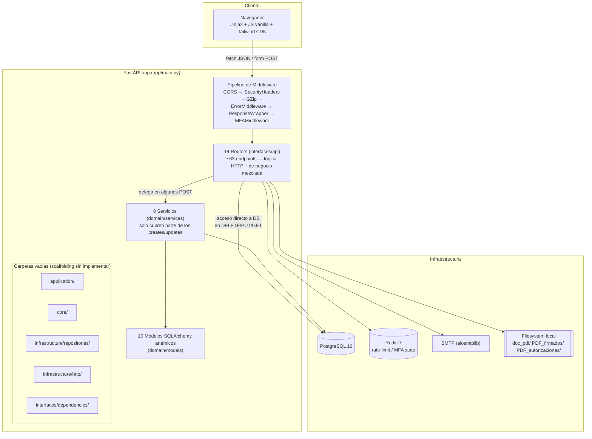
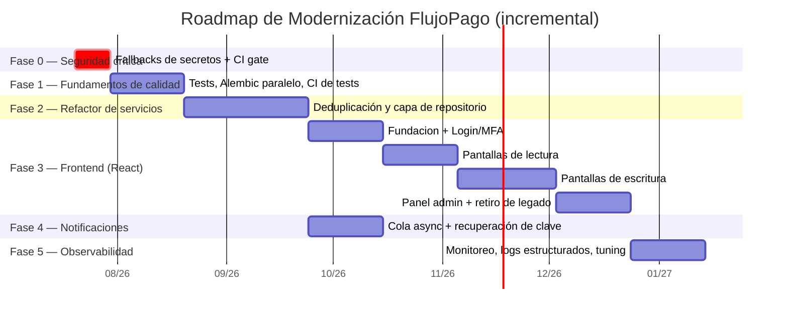

# Auditoría Técnica y Plan de Modernización — Proyecto FlujoPago

**Sistema de Gestión de Pagos FlujoPago (empresas de ejemplo: ANDES / CORDILLERA / PACIFICO)**

|                                                     |                                                             |
| --------------------------------------------------- | ----------------------------------------------------------- |
| **Tipo de documento**                         | Auditoría de arquitectura y hoja de ruta de modernización |
| **Alcance**                                   | Análisis únicamente. Sin cambios de código.              |
| **Rama analizada**                            | `mac_maximiliano`                                         |
| **Líneas de código backend (`app/`)**     | 10.547 líneas Python                                       |
| **Líneas de código frontend (`public/`)** | 15.355 líneas JS + 4.354 líneas CSS                       |
| **Endpoints API**                             | 63 rutas (57 JSON puro / 6 HTML)                            |

> **Nota de método:** todos los hallazgos citan archivo y línea exacta dentro del repositorio. Se contrastaron contra la documentación ya existente (`README.md`, `DOC_*.md`, `.github/workflows/`) para no duplicar recomendaciones sobre lo que el equipo ya conoce o ya tiene planificado. Cuando algo ya está bien resuelto, se indica explícitamente como fortaleza — el objetivo es evolucionar, no reescribir.

---

## Índice

1. [Arquitectura actual](#1-arquitectura-actual)
2. [Stack tecnológico](#2-stack-tecnológico)
3. [Modernización del Frontend](#3-modernización-del-frontend-prioridad-alta)
4. [Experiencia de Usuario (UX)](#4-experiencia-de-usuario-ux)
5. [Sistema de Notificaciones](#5-sistema-de-notificaciones)
6. [Seguridad](#6-seguridad)
7. [Rendimiento](#7-rendimiento)
8. [Escalabilidad](#8-escalabilidad)
9. [Calidad del Código](#9-calidad-del-código)
10. [Plan de Migración](#10-plan-de-migración)
11. [Impacto sobre el Código](#11-impacto-sobre-el-código)
12. [Priorización](#12-priorización)
13. [Conclusión Ejecutiva](#13-conclusión-ejecutiva)

---

## Resumen Ejecutivo

FlujoPago es una plataforma interna de gestión de solicitudes de pago (remuneraciones, finiquitos, anticipos, préstamos, BTN, erogación voluntaria) con flujo de aprobación multinivel para tres empresas del grupo (ANDES, CORDILLERA, PACIFICO). El backend está construido con **FastAPI + SQLAlchemy async + PostgreSQL**, siguiendo una intención de **arquitectura hexagonal** razonablemente aplicada en sus capas de dominio (DTOs con Pydantic v2, modelos SQLAlchemy, servicios). El frontend es **100% renderizado en servidor (Jinja2) + JavaScript vanilla + Tailwind CSS vía CDN**, sin build ni framework.

**El backend es sólido en seguridad de base** (Argon2id, TOTP/2FA, rate-limiting con Redis, cabeceras de seguridad, protección contra path-traversal, sin inyección SQL detectada, enmascarado de errores) pero contiene **defectos críticos puntuales y fáciles de corregir de forma incremental**: claves secretas (`SECRET_KEY`, `FERNET_KEY`) con valores por defecto embebidos en el código fuente que se activan silenciosamente si falta la variable de entorno, y un bypass de dominio de correo hardcodeado en producción (cambiar una vez creada las credenciales en .env - metodo usado para tener un respaldo antes de la entrega). Estos son los únicos hallazgos que deberían tratarse como **urgentes**; el resto del sistema funciona correctamente y no requiere intervención de emergencia.

**El mayor riesgo de mediano plazo no es de seguridad sino de mantenibilidad**: 5 de las carpetas que anuncian la arquitectura hexagonal (`app/application`, `app/core`, `app/infrastructure/repositories`, `app/infrastructure/http`, `app/interfaces/dependencies`) están vacías, no existe capa de repositorio real, hay lógica de negocio duplicada casi byte-a-byte entre servicios gemelos (`recepcionado_service.py` ↔ `todas_solicitudes.py`), y el frontend (15.355 líneas de JS sin módulos, sin bundler, con 3 sistemas de paginación superpuestos) se ha vuelto difícil de escalar en features.

**Recomendación central:** modernizar de forma **incremental y no disruptiva** (patrón *strangler fig*), en el orden: (1) cerrar los 2 hallazgos críticos de seguridad (cambiar una vez creada las credenciales en .env)— bajo esfuerzo, alto impacto; (2) consolidar la capa de servicios y eliminar duplicación; (3) migrar el frontend a **React + TypeScript** progresivamente, reutilizando el 90% de la API JSON ya existente; (4) incorporar cola de notificaciones y observabilidad. Ninguna fase requiere detener el sistema ni reescribir el backend.

---

## 1. Arquitectura actual

### 1.1 Estructura del proyecto

```
app/
├── application/          ← VACÍO (solo __init__.py, 0 bytes)
├── core/                 ← VACÍO (solo __init__.py, 0 bytes)
├── domain/
│   ├── dto/               10 módulos Pydantic (872 líneas)
│   ├── models/             10 modelos SQLAlchemy (anémicos)
│   ├── schemas/            response_schemas.py (envelope genérico)
│   └── services/           8 servicios (lógica de negocio + acceso a datos mezclados)
├── infrastructure/
│   ├── db/                 database.py, db_seed.py
│   ├── http/              ← VACÍO (solo __init__.py, 0 bytes)
│   ├── mailing/            email_service.py
│   ├── middleware/         6 middlewares
│   ├── repositories/      ← VACÍO (solo __init__.py, 0 bytes)
│   ├── security/           auth, JWT, MFA, hashing, Redis
│   └── utils/               logger, paginación, PDF, validaciones, response wrapper
└── interfaces/
    ├── api/routers/         14 routers, 3.283 líneas, ~63 endpoints
    ├── api/templates/       9 plantillas Jinja2
    └── dependencies/       ← VACÍO (solo __init__.py, 0 bytes)
```

**Hallazgo estructural principal:** el proyecto **anuncia** una arquitectura hexagonal completa (application / domain / infrastructure / interfaces, con capa de repositorios y de dependencias) pero **5 de esos paquetes existen únicamente como carpetas vacías** con un `__init__.py` en blanco:

| Carpeta                              | Propósito anunciado                              | Estado real                                                                                 |
| ------------------------------------ | ------------------------------------------------- | ------------------------------------------------------------------------------------------- |
| `app/application/`                 | Casos de uso / orquestación                      | Vacía — 0 archivos además de`__init__.py`                                              |
| `app/core/`                        | Configuración central, base de seguridad         | Vacía — el rol lo cumple hoy`app/infrastructure/*`                                      |
| `app/infrastructure/repositories/` | Patrón Repository                                | Vacía —**no existe capa de repositorio en ningún punto del código**               |
| `app/infrastructure/http/`         | Clientes HTTP salientes                           | Vacía                                                                                      |
| `app/interfaces/dependencies/`     | Proveedores de dependencias FastAPI (`Depends`) | Vacía — las dependencias viven inline en cada router o en`app/infrastructure/security/` |

Esto no rompe nada hoy (Python no exige que un paquete tenga contenido), pero es deuda técnica silenciosa: cualquier desarrollador nuevo que lea la estructura de carpetas construye un modelo mental incorrecto de dónde vive cada cosa.

### 1.2 Dónde ocurre realmente el acceso a datos

Sin capa de repositorio, el acceso a base de datos (SQLAlchemy Core `select`/`insert`/`update`/`delete` + `session.commit()`) ocurre en dos lugares distintos según el endpoint:

- **A través de un servicio** (`app/domain/services/*.py`) — solo en las rutas de **creación** de la mayoría de entidades y en el ciclo de vida de `recepcionado`/`todas_solicitudes`.
- **Directamente en el router** (`app/interfaces/api/routers/*.py`) — en **todos los `DELETE`, la mayoría de `PUT`/`PATCH`, y todos los `GET` con filtros**. Ejemplos: `empresa_routes.py:70-99` (eliminar/modificar), `usuario_routes.py:229-258` (modificar, incluye hashing de password y gestión de tabla M2M inline).

Esto significa que la "capa de servicios" cubre menos de la mitad de las operaciones de escritura reales — el resto vive mezclado con el código HTTP.

### 1.3 Diagrama de arquitectura actual



### 1.4 Patrones de diseño en uso

| Patrón                                              | ¿Implementado?                       | Evidencia                                                                                                                                                 |
| ---------------------------------------------------- | ------------------------------------- | --------------------------------------------------------------------------------------------------------------------------------------------------------- |
| Middleware pipeline                                  | ✅ Sí, correctamente                 | `app/main.py:93-99`, 6 middlewares encadenados                                                                                                          |
| Inyección de dependencias (FastAPI`Depends`)      | ✅ Sí, ampliamente                   | `get_db`, `get_current_user`, `require_admin` en casi todos los routers                                                                             |
| DTO / Data Transfer Object                           | ✅ Sí (vía Pydantic)                | `app/domain/dto/*.py`, 872 líneas                                                                                                                      |
| Response envelope unificado                          | ✅ Sí                                | `app/domain/schemas/response_schemas.py` + `ResponseWrapperMiddleware`                                                                                |
| Repository pattern                                   | ❌ No — solo scaffolding vacío      | `app/infrastructure/repositories/__init__.py` (0 bytes)                                                                                                 |
| Capa de casos de uso / Application services          | ❌ No                                 | `app/application/__init__.py` (0 bytes)                                                                                                                 |
| Domain model rico (validaciones/reglas en el modelo) | ❌ No — modelos 100% anémicos       | 0 coincidencias de`@validates`/`@property`/`@hybrid_property` en `app/domain/models/`                                                             |
| Factory de dependencias por rol (RBAC)               | ✅ Sí, centralizado                  | `require_role`/`require_admin` en `auth_token_roles.py:67-116`                                                                                      |
| Rutas de autenticación duplicadas/paralelas         | ⚠️ Existe una segunda vía sin usar | `dependencia_token.py` (HTTPBearer + carga de ORM completo) — **0 routers la importan**, es código muerto en paralelo a `auth_token_roles.py` |

### 1.5 Deuda técnica principal encontrada

| #  | Hallazgo                                                                                  | Evidencia                                                                                                                                                                                                                                                                                                                                                                                                                                                                                             | Impacto                                                                                                                                                                                                                                                                                                                                                     |
| -- | ----------------------------------------------------------------------------------------- | ----------------------------------------------------------------------------------------------------------------------------------------------------------------------------------------------------------------------------------------------------------------------------------------------------------------------------------------------------------------------------------------------------------------------------------------------------------------------------------------------------- | ----------------------------------------------------------------------------------------------------------------------------------------------------------------------------------------------------------------------------------------------------------------------------------------------------------------------------------------------------------- |
| 1  | Duplicación casi byte-a-byte de lógica de negocio entre "solicitudes" y "recepcionados" | Bloque de 17 líneas idéntico en`recepcionado_service.py:201-217` y `todas_solicitudes.py:264-279` (limpieza de campos de folio)                                                                                                                                                                                                                                                                                                                                                                 | Cualquier corrección de regla de negocio debe aplicarse dos veces; alto riesgo de que se apliquen de forma inconsistente (ya ocurre: manejo de errores distinto entre`procesos_service.py` (lanza `HTTPException`) y `proceso_auxiliares_service.py` (retorna tupla `(None, error)`) para la misma operación "crear con validación de unicidad") |
| 2  | Enums y bloques de 20 campos de folio duplicados 9 veces                                  | `todas_solicitudesDTO.py`, `recepcionadoDTO.py`, `historicoDTO.py` — cada uno redeclara `EstadoSolicitud`, `Meses_validos`, `Forma_Pago` y el bloque `folio_uno..cinco` en sus clases `In`/`Update`/`Out`                                                                                                                                                                                                                                                                    | Un cambio de enum (ej. agregar un nuevo estado) exige tocar 3 archivos en 9 lugares                                                                                                                                                                                                                                                                         |
| 3  | Lógica de filtrado de permisos por "obra" duplicada en 3 routers                         | `historico_routes.py:46-77,126-155`, `recepcionado_routes.py:41-95`, `todas_solicitudes_routes.py:39-79,252-266,416-430`                                                                                                                                                                                                                                                                                                                                                                        | Un bug de seguridad en el filtro debe corregirse en 5+ lugares; de hecho**2 endpoints de histórico ya omiten el filtro** (`/historico/estado/{estado}`, `/historico/solicitante/{solicitante}`)                                                                                                                                                  |
| 4  | God files (>300 líneas, múltiples responsabilidades)                                    | `mfa_routes.py` (605 líneas), `recepcionado_service.py` (517), `todas_solicitudes_routes.py` (456), `todas_solicitudes.py` service (388), `historico_routes.py` (372), `recepcionado_routes.py` (345), `db_seed.py` (333), `dashboard_routes.py` (332)                                                                                                                                                                                                                               | Difícil de testear y de revisar en PR;`mfa_routes.py` mezcla ruteo HTTP, fingerprinting de dispositivo, orquestación de email-OTP y persistencia de dispositivos de confianza                                                                                                                                                                           |
| 5  | Funciones de +100 líneas con validación + cálculo + persistencia mezclados             | `recepcionado_service.py:16-191` (176 líneas), `todas_solicitudes.py:232-387` (156 líneas), `todas_solicitudes_routes.py:95-232` (`crear_todas_solicitudes`, 138 líneas, mezcla autorización + parsing de multipart + validación)                                                                                                                                                                                                                                                        | Imposible testear unitariamente una sub-responsabilidad sin mockear todo                                                                                                                                                                                                                                                                                    |
| 6  | Sin capa de migraciones (Alembic)                                                         | `database.py:109-146` ejecuta `ALTER TABLE ... ADD COLUMN IF NOT EXISTS` a mano en cada arranque                                                                                                                                                                                                                                                                                                                                                                                                  | Funciona hoy, pero no hay historial de versiones de esquema ni rollback; ya documentado como decisión conocida en`DOC_TECHNICAL_DOCUMENTATION.md`                                                                                                                                                                                                        |
| 7  | Código y dependencias muertas                                                            | `dependencia_token.py` (0 routers lo usan), `require_admin_or_supervisor` (0 llamadas), `pdf_firmado_routes.py:14` importa `registrar_cambio_historico` sin usarlo, `roles_routes.py:39-47` contiene un endpoint de login falso comentado dentro de un router activo, dependencia `passlib[bcrypt]` en `requirements.txt` nunca importada, dependencia `fastapi-limiter` en `requirements.txt` nunca importada (el rate-limiting real es un wrapper propio sobre `redis.asyncio`) | Ruido que confunde a nuevos desarrolladores y aumenta superficie de auditoría de dependencias sin beneficio                                                                                                                                                                                                                                                |
| 8  | Naming inconsistente                                                                      | Modelos con 3 convenciones distintas (`Usuarios`, `Tabla_Todas_Solicitudes`, `TablaHistorico`); archivo `middelware_base_headers.py` (typo); logger de un servicio nombrado `"procesos_rootes"` (copiado de un router)                                                                                                                                                                                                                                                                  | Fricción cognitiva, no afecta funcionamiento                                                                                                                                                                                                                                                                                                               |
| 9  | Modelo de dominio anémico                                                                | 0 lógica de negocio en`app/domain/models/*.py`; toda regla vive en el servicio o, peor, en el router                                                                                                                                                                                                                                                                                                                                                                                               | Dificulta reutilizar reglas de negocio fuera del handler HTTP que las invocó primero                                                                                                                                                                                                                                                                       |
| 10 | Cobertura de tests desigual                                                               | `mfa_routes.py` (el router más grande, 605 líneas) tiene **0% de cobertura automatizada** (pytest); `app/infrastructure/repositories/` (vacío) y casi todos los servicios de dominio solo se ejercitan indirectamente vía tests de router con mocks; `conftest.py:7-9` **mockea Argon2 globalmente**, por lo que el hashing real de contraseñas nunca se ejecuta en la suite de tests                                                                                          | Cambios en MFA o en hashing pueden romperse sin que ningún test lo detecte                                                                                                                                                                                                                                                                                 |

---

## 2. Stack tecnológico

### 2.1 Backend

| Tecnología                            | Versión                          | Ventajas                                                                                                | Limitaciones                                                                                                                                                                                       | Estado                                                                            | Recomendación                                                                                                                          | Riesgo                                      |
| -------------------------------------- | --------------------------------- | ------------------------------------------------------------------------------------------------------- | -------------------------------------------------------------------------------------------------------------------------------------------------------------------------------------------------- | --------------------------------------------------------------------------------- | --------------------------------------------------------------------------------------------------------------------------------------- | ------------------------------------------- |
| **FastAPI**                      | 0.104.1                           | Async nativo, validación automática vía Pydantic, OpenAPI gratis, alto rendimiento                   | Versión de sept. 2023, no la más reciente (1.x aún no existe pero hay releases posteriores con fixes)                                                                                           | Activo, bien usado                                                                | Mantener; actualizar a la última 0.11x                                                                                                 | Bajo                                        |
| **Uvicorn + uvloop + httptools** | 0.24.0 / 0.19.0 / 0.6.1           | Servidor ASGI de alto rendimiento                                                                       | Ejecutado sin gestor de procesos (Gunicorn/supervisor) en`Dockerfile` — un solo proceso Uvicorn                                                                                                 | Activo                                                                            | Mantener Uvicorn; añadir`--workers` o Gunicorn+UvicornWorker para aprovechar múltiples núcleos en producción                      | Bajo-Medio                                  |
| **Pydantic**                     | 2.5.0                             | Validación robusta,`computed_field`, rendimiento (core en Rust)                                      | Ninguna relevante                                                                                                                                                                                  | Activo, bien usado                                                                | Mantener, actualizar patch version                                                                                                      | Bajo                                        |
| **SQLAlchemy (async)**           | 2.0.23                            | ORM maduro, soporte async real, tipado moderno (`Mapped`)                                             | Se usa como "Core" (SQL explícito) en vez de aprovechar el ORM declarativo con relaciones — solo 2`relationship()` en todo el proyecto                                                         | Activo                                                                            | Mantener; considerar adoptar más`relationship()`/`selectinload` para reducir joins manuales repetidos                              | Bajo                                        |
| **psycopg[binary] / asyncpg**    | 3.1.18 / 0.29.0                   | Ambos drivers Postgres presentes                                                                        | Redundancia: dos drivers Postgres declarados cuando SQLAlchemy async solo necesita uno (`asyncpg`)                                                                                               | Redundante                                                                        | Confirmar cuál se usa realmente en`DATABASE_URL` y eliminar el driver no utilizado de `requirements.txt`                           | Bajo                                        |
| **Jinja2**                       | 3.1.4                             | Simple, probado, ideal para las 6 rutas HTML restantes                                                  | Ya no es el paradigma principal de la UI (ver sección 3)                                                                                                                                          | Transicional                                                                      | Mantener durante la migración; retirar al finalizar Fase 3                                                                             | Bajo                                        |
| **PostgreSQL**                   | 16 (Docker`postgres:16-alpine`) | Robusto, open-source, soporta JSON, particionado, excelente para cargas transaccionales                 | Ninguna relevante al tamaño actual                                                                                                                                                                | Activo                                                                            | Mantener                                                                                                                                | Bajo                                        |
| **Sin Alembic**                  | —                                | El arranque autoaplica`ALTER TABLE IF NOT EXISTS` (`database.py:109-146`) — simple y funciona      | Sin versionado de esquema, sin downgrade, riesgo si dos entornos divergen                                                                                                                          | Funcional pero riesgoso a mediano plazo                                           | Introducir Alembic**en paralelo** (no reemplazar de inmediato) para nuevas migraciones                                            | Medio                                       |
| **Redis**                        | 7-alpine                          | Rápido, ya usado para rate-limit/MFA state                                                             | Instancia única, sin réplica;**si cae, el rate-limiting se desactiva silenciosamente ("fail-open")** (`redis_service.py`, todas las funciones retornan "ok" si `redis_client is None`) | Activo, bien implementado salvo el fail-open                                      | Mantener el diseño; añadir alerta/monitoreo activo cuando Redis no esté disponible, y evaluar Redis Sentinel/cluster si el uso crece | Medio                                       |
| **Argon2 (argon2-cffi)**         | 23.1.0                            | Hashing de contraseña moderno, parámetros fuertes (`time_cost=3, memory_cost=64MiB, parallelism=2`) | Ninguna                                                                                                                                                                                            | Activo, correctamente configurado                                                 | Mantener                                                                                                                                | Bajo                                        |
| **passlib[bcrypt]**              | 1.7.4                             | —                                                                                                      | **Dependencia muerta**: 0 imports en `app/` (confirmado por grep); coexiste con un comentario obsoleto que menciona "bcrypt" en `tabla_usuarios.py:23` cuando el hash real es Argon2     | No utilizada                                                                      | Eliminar de`requirements.txt` y corregir el comentario                                                                                | Bajo                                        |
| **PyJWT**                        | 2.10.1                            | Estándar, simple                                                                                       | El token embebe rol/cargo — no se re-valida contra DB en cada request (cambio de rol solo aplica al reemitir token)                                                                               | Activo                                                                            | Mantener; documentar el trade-off o añadir invalidación por versión de rol                                                           | Bajo-Medio                                  |
| **cryptography (Fernet)**        | 42.0.5                            | Cifrado simétrico simple para secretos TOTP en reposo                                                  | Sin rotación de clave, sin soporte multi-clave                                                                                                                                                    | Activo, con hallazgo crítico (ver sección 6)                                    | Mantener el mecanismo; corregir el fallback hardcodeado y planificar rotación                                                          | Alto (por el fallback, no por la librería) |
| **pyotp / qrcode**               | 2.9.0 / 7.4.2                     | Estándar RFC 6238 para TOTP                                                                            | Ninguna                                                                                                                                                                                            | Activo                                                                            | Mantener                                                                                                                                | Bajo                                        |
| **fastapi-limiter**              | 0.1.6                             | —                                                                                                      | **Dependencia declarada pero nunca importada** — el rate-limiting real es un wrapper propio sobre `redis.asyncio` en `redis_service.py`                                                 | No utilizada                                                                      | Eliminar de`requirements.txt`, o adoptarla formalmente si se desea estandarizar (no obligatorio, lo actual funciona)                  | Bajo                                        |
| **aiosmtplib / premailer**       | 3.0.1 / 3.10.0                    | Envío async de correo con CSS inline                                                                   | El envío ocurre**síncrono dentro del request** (`await` bloqueante en el handler) — una SMTP lenta demora la respuesta HTTP                                                             | Activo, funcional                                                                 | Ver sección 5 — mover a cola asíncrona                                                                                               | Medio                                       |
| **pikepdf**                      | 8.11.2                            | Optimización/saneamiento de PDFs subidos                                                               | Ninguna relevante                                                                                                                                                                                  | Activo, bien usado (incluye sanitización de nombre de archivo y fallback seguro) | Mantener                                                                                                                                | Bajo                                        |
| **orjson / httpx**               | 3.10.15 / 0.24.1                  | Serialización rápida, cliente HTTP                                                                    | `httpx` 0.24.1 es antiguo (2023)                                                                                                                                                                 | Activo                                                                            | Actualizar`httpx` a una versión reciente                                                                                             | Bajo                                        |

### 2.2 Frontend

| Tecnología                        | Cómo se usa hoy                                                                                                                   | Ventajas                    | Limitaciones                                                                                                                                                                                                                                                                               | Recomendación                                                                                 | Riesgo                |
| ---------------------------------- | ---------------------------------------------------------------------------------------------------------------------------------- | --------------------------- | ------------------------------------------------------------------------------------------------------------------------------------------------------------------------------------------------------------------------------------------------------------------------------------------ | ---------------------------------------------------------------------------------------------- | --------------------- |
| **Jinja2 templates**         | 9 plantillas HTML, 100% server-rendered, sin datos de negocio inyectados server-side (todo se hidrata vía`fetch()` tras cargar) | Simple, sin build           | Duplica responsabilidad con el JS del cliente; las 6 rutas HTML son en la práctica solo "shells" de autenticación                                                                                                                                                                        | Retirar progresivamente en Fase 3 (sección 3)                                                 | Bajo                  |
| **JavaScript vanilla**       | 28 archivos, 15.355 líneas, sin módulos ES/bundler                                                                               | Cero dependencias de build  | Sin tipado, sin tree-shaking,`app.js` (2.525 líneas) declara 30 funciones globales en `window`, fuerte uso de `onclick=` inline (24 solo en `dashboard.html`)                                                                                                                     | Migrar a componentes tipados (sección 3)                                                      | Alto (mantenibilidad) |
| **Tailwind CSS**             | Cargado vía**Play CDN** (`cdn.tailwindcss.com`) en cada plantilla, sin build                                              | Prototipado rápido         | El propio equipo de Tailwind**desaconseja el Play CDN en producción** (sin purga de clases no usadas, cientos de KB innecesarios, sin cache-busting real, config duplicada 3 veces de forma idéntica entre `index_tailwind.js`/`mfa_tailwind.js`/`force_change_tailwind.js`) | Migrar a Tailwind compilado (CLI/PostCSS) al introducir el build del SPA                       | Medio                 |
| **Font Awesome 6.4.0**       | Vía CDN                                                                                                                           | Amplio catálogo de íconos | Carga completa de la librería para unos pocos íconos usados                                                                                                                                                                                                                              | Sustituir por un set de íconos SVG tree-shakeable (ej.`lucide-react`) durante la migración | Bajo                  |
| **xlsx-js-style**            | CDN, solo para exportar Excel en`dashboard.html`                                                                                 | Funcional                   | Dependencia de terceros sin pin de integridad (SRI)                                                                                                                                                                                                                                        | Añadir`integrity`/`crossorigin` si se mantiene vía CDN, o empaquetarla                   | Bajo                  |
| **Sin bundler/empaquetador** | No existe`package.json` en el repo                                                                                               | —                          | Sin minificación, sin tree-shaking, sin code-splitting, 17`<script>` en `dashboard.html` cargados individualmente                                                                                                                                                                     | Introducir Vite en la Fase 3                                                                   | Medio                 |

### 2.3 Infraestructura, autenticación, CI/CD

| Categoría                     | Estado actual                                                                                                                                                                                                                                    | Ventajas                                                                           | Limitaciones                                                                                                                                                                                                                                                                                       | Recomendación                                                                                                                                             | Riesgo                                                             |
| ------------------------------ | ------------------------------------------------------------------------------------------------------------------------------------------------------------------------------------------------------------------------------------------------ | ---------------------------------------------------------------------------------- | -------------------------------------------------------------------------------------------------------------------------------------------------------------------------------------------------------------------------------------------------------------------------------------------------- | ---------------------------------------------------------------------------------------------------------------------------------------------------------- | ------------------------------------------------------------------ |
| **Docker**               | `Dockerfile` single-stage, `python:3.11-slim-bookworm`, usuario no-root, instala deps con `uv`                                                                                                                                             | Imagen razonable, seguridad básica correcta (usuario no-root)                     | Single-stage (imagen final incluye`build-essential`/`gcc`); comando de arranque es Uvicorn puro sin gestor de workers                                                                                                                                                                          | Migrar a build multi-stage (builder + runtime) para reducir tamaño de imagen; añadir`--workers N` o Gunicorn                                           | Bajo                                                               |
| **Docker Compose**       | 4 servicios:`db`, `redis`, `app`, `db-backup` con healthchecks y límites de recursos                                                                                                                                                    | Buena práctica: healthchecks, límites de CPU/memoria, backup automatizado diario | Sin réplicas,`app` monta el código como volumen (`./:/code`) incluso en la config de "producción" del compose, junto con `--reload` en el comando                                                                                                                                         | Separar compose de desarrollo (con`--reload`+volumen) de un compose/manifiesto de producción sin volumen de código y sin `--reload`                  | Medio                                                              |
| **CI/CD**                | **Único workflow existente:** `.github/workflows/security-workflow.yml` — escaneo de dependencias (`safety`, `pip-audit`), paquetes desactualizados, licencias, SBOM, reporte PDF                                                  | Cobertura de supply-chain ya implementada y con cron diario                        | **No hay ningún workflow que ejecute los tests (`pytest`), linting, ni build/deploy.** Además, todos los jobs de escaneo usan `continue-on-error: true`, por lo que la política declarada en `security-config.json` ("bloquear merge en crítico") **no se aplica realmente** | Añadir un workflow de CI que ejecute`pytest` + linter (`ruff`) en cada PR; quitar `continue-on-error` del job crítico o añadir un gate explícito | Alto (calidad) / Medio (seguridad de proceso)                      |
| **Autenticación**       | JWT (HS256) + cookie httpOnly/SameSite=Lax o Bearer header                                                                                                                                                                                       | Patrón estándar y correcto                                                       | Ver hallazgos críticos en sección 6                                                                                                                                                                                                                                                              | Corregir en Fase 0                                                                                                                                         | Ver sección 6                                                     |
| **Autorización**        | RBAC centralizado vía`require_role`/`require_admin`                                                                                                                                                                                         | Centralizado y consistente en la mayoría de rutas de escritura                    | Autorización por "obra" (unidad de negocio) duplicada por router, no centralizada                                                                                                                                                                                                                 | Extraer a una dependencia/policy compartida (Fase 2)                                                                                                       | Medio                                                              |
| **Variables de entorno** | `.env` + `python-dotenv`, `.env.example` documentado y completo                                                                                                                                                                            | Simple, adecuado para el tamaño del equipo                                        | Sin vault/gestor de secretos, sin rotación, y**3 secretos tienen fallback hardcodeado en código** (ver sección 6)                                                                                                                                                                         | Fail-fast en vez de fallback silencioso; evaluar un vault (Doppler/Vault/AWS Secrets Manager) solo si el equipo/infra crece                                | Alto (por los fallbacks)                                           |
| **Caché**               | Redis usado solo para estado de seguridad (intentos de login/MFA, OTP pendiente) —**no hay caché de aplicación** para lecturas frecuentes                                                                                               | —                                                                                 | Cada`GET` de listados golpea Postgres directamente                                                                                                                                                                                                                                               | Evaluar caché de lectura (ej. TTL corto sobre catálogos poco cambiantes: empresas, roles, procesos) — bajo impacto/alto beneficio                       | Bajo                                                               |
| **Almacenamiento**       | Filesystem local (`doc_pdf/`, `PDF_firmados/`, `PDF_autorizaciones/`) + backup diario de Postgres vía contenedor `db-backup` + script `scripts/backup_s3.sh` (subida a S3 **comentada**, pendiente de credenciales del cliente) | Backups de BD automáticos y con retención (7d/4sem/12m) ya funcionando           | Los PDFs**no** se replican fuera del host (solo se respaldan localmente el propio filesystem no tiene backup automatizado más allá del script manual comentado)                                                                                                                            | Activar la subida a S3 (o equivalente) del script existente en cuanto se disponga de credenciales — ya está construido, solo falta habilitarlo           | Medio (riesgo de pérdida de documentos firmados si el host falla) |
| **APIs externas**        | Únicamente SMTP (correo)                                                                                                                                                                                                                        | Simple                                                                             | Ninguna integración con pasarelas de pago, ERPs, etc. detectada                                                                                                                                                                                                                                   | N/A                                                                                                                                                        | —                                                                 |

---

## 3. Modernización del Frontend (Prioridad Alta)

### 3.1 Diagnóstico de partida

El frontend actual es un **monolito de JavaScript vanilla sin build**, servido como archivos estáticos por FastAPI (`app/main.py:122-124`, `app.mount("/public", ...)`). Datos clave:

- 28 archivos JS (15.355 líneas), 8 CSS (4.354 líneas), **0 archivos de configuración de build** (`package.json`, `vite.config`, `webpack.config` — ninguno existe).
- `app.js` es un monolito de 2.525 líneas con 30 funciones globales colgadas de `window`, sin módulos.
- **3 sistemas de paginación superpuestos** (`pagination.js`, `frontend_pagination.js`, `app_pagination_functions.js`) que un desarrollador debe conocer para tocar cualquier tabla.
- Tailwind se sirve desde el **Play CDN**, no compilado — explícitamente desaconsejado por el propio Tailwind Labs para producción.
- **0 atributos `aria-*` y 0 asociaciones `<label for=...>`** en las 9 plantillas — el sistema no pasaría una auditoría WCAG básica.
- Las páginas de error HTTP (401/403/404/422/500) son 5 documentos HTML completos con ~1.600 líneas de CSS casi idéntico duplicado, y contenido temático ("minería"/`supervisor@miningops.com`) que no corresponde a la marca de FlujoPago — residuo de una plantilla genérica.

**Buena noticia para la migración:** el backend ya está preparado. De los 63 endpoints, **57 devuelven JSON puro** con `response_model` tipado; solo 6 rutas devuelven HTML, y ninguna de ellas inyecta datos de negocio server-side (son *shells* de autenticación que luego hidratan todo vía `fetch()`). Esto significa que **migrar el frontend no requiere reescribir el backend** — es, en esencia, un reemplazo de capa de presentación consumiendo el mismo contrato API `/flujopago/gestion-pagos/v1/...`.

### 3.2 Comparativa Angular vs React

| Criterio                                                      | Angular (v17+)                                                                                                                                                    | React (v18+)                                                                                                                                                                                |
| ------------------------------------------------------------- | ----------------------------------------------------------------------------------------------------------------------------------------------------------------- | ------------------------------------------------------------------------------------------------------------------------------------------------------------------------------------------- |
| **Compatibilidad con el backend actual**                | Total — consume el mismo API JSON;`HttpClient` + interceptores mapean 1:1 al envelope `APIResponse` ya existente                                             | Total — igual, vía`fetch`/`axios` + `TanStack Query`, que encaja muy bien con el patrón de envelope+paginación ya usado en `pagination_utils.py`                                |
| **Facilidad de migración incremental (strangler fig)** | Posible pero más rígida — Angular espera "poseer" el`<html>` raíz o usar Elements/Web Components para islas parciales, con más fricción de configuración | Más simple — se pueden montar "islas" de React dentro de una página Jinja2 existente (ej. reemplazar solo`admin.js` por un componente React) sin reescribir toda la página de una vez |
| **Curva de aprendizaje para el equipo actual**          | Alta — requiere adoptar TypeScript obligatorio, RxJS, DI de Angular, CLI propio; el equipo hoy trabaja con JS vanilla imperativo, salto conceptual grande        | Media — el modelo mental (funciones, props, estado local) es más cercano a lo que ya existe en`data.js`/`Admin`/`Forms` (objetos con funciones); TypeScript es opcional al inicio   |
| **Rendimiento**                                         | Excelente (Ivy renderer, detección de cambios optimizada)                                                                                                        | Excelente (Virtual DOM + concurrent rendering en v18); para el volumen de datos de FlujoPago (tablas paginadas, no miles de filas simultáneas) la diferencia es irrelevante en la práctica     |
| **Mantenibilidad**                                      | Alta — framework opinionado, estructura impuesta (módulos, servicios, DI) reduce deriva de estilo entre desarrolladores                                         | Alta si se adopta una convención de proyecto (ej. feature folders + TanStack Query + Zod) — más libertad implica más disciplina de equipo necesaria                                     |
| **Escalabilidad del código**                           | Muy buena para equipos grandes con convenciones estrictas                                                                                                         | Muy buena, con ecosistema más grande de soluciones intercambiables (routing, forms, data-fetching)                                                                                         |
| **Ecosistema**                                          | Más acotado pero muy cohesionado (Angular Material, Angular CLI, RxJS)                                                                                           | Ecosistema más amplio y con mayor bolsa de talento en LatAm (más relevante para contratación futura)                                                                                     |
| **Soporte a largo plazo**                               | Google, ciclo de versiones semestral con LTS de 18 meses                                                                                                          | Meta, sin versiones "rotas" desde v16, adopción masiva de la industria                                                                                                                     |
| **Facilidad para pruebas**                              | Buena (TestBed integrado, pero configuración más pesada)                                                                                                        | Muy buena y liviana (`@testing-library/react` + `Vitest`), encaja bien con `pytest` del backend en filosofía de test                                                                 |
| **Riesgos de adopción**                                | Mayor esfuerzo de "buy-in" del equipo (DI, RxJS); reescritura más "todo o nada" por convención del framework                                                    | Requiere más disciplina de arquitectura propia (no viene impuesta); riesgo de fragmentación si no se define una convención desde el día 1                                               |

### 3.3 Recomendación

**Se recomienda React 18 + TypeScript + Vite**, con **TanStack Query** para consumo de datos (encaja naturalmente con el envelope `APIResponse` y el patrón de paginación ya usado en `pagination_utils.py`) y **React Router** para navegación cliente.

**Justificación técnica:**

1. El backend ya expone una API JSON versionada y estable — no se necesita el enfoque "full-framework" de Angular para imponer estructura al backend, porque el backend **ya tiene** su propia estructura (FastAPI + Pydantic).
2. La migración por *strangler fig* (reemplazar pantalla por pantalla, manteniendo Jinja2 y JS legado funcionando en paralelo) es más natural en React, donde un componente puede montarse en un `<div id="admin-root">` dentro de una plantilla existente sin migrar toda la página de una vez.
3. Menor salto conceptual para el equipo actual (que ya piensa en términos de objetos con funciones como `Admin`, `Forms`, `Workflow` en el JS actual) — reduce el riesgo de la migración.
4. Mayor disponibilidad de talento React en el mercado local, relevante si el equipo crece.

Angular seguiría siendo una alternativa técnicamente válida si el equipo prefiriera un framework más opinionado que imponga convenciones (lo cual podría alinearse filosóficamente con la intención de arquitectura hexagonal del backend) — se documenta aquí para que la decisión final quede en manos del equipo, pero **React es la recomendación por menor riesgo de migración incremental**.

### 3.4 Estrategia de migración incremental (Strangler Fig)

```mermaid
flowchart LR
    subgraph Hoy["Estado actual"]
        J1["Jinja2 + JS vanilla<br/>(9 plantillas)"]
    end

    subgraph F1["Fase 3.1 — Fundacion"]
        V["Vite + React + TS<br/>conviviendo con Jinja2"]
        L["Login + MFA<br/>(bajo riesgo, aislado)"]
    end

    subgraph F2["Fase 3.2 — Lectura"]
        H["Histórico<br/>(solo lectura)"]
        R["Recepcionados<br/>(lectura)"]
    end

    subgraph F3["Fase 3.3 — Escritura"]
        S["Solicitudes<br/>(CRUD completo)"]
        Rec["Recepcionados<br/>(CRUD completo)"]
    end

    subgraph F4["Fase 3.4 — Admin y cierre"]
        A["Panel Admin<br/>(mayor complejidad, último)"]
        Cut["Retiro de Jinja2 legado<br/>+ JS vanilla"]
    end

    Hoy --> F1 --> F2 --> F3 --> F4
```



**Por qué este orden:** se empieza por Login/MFA porque son pantallas aisladas, ya con lógica bien encapsulada (`Security`, `mfa.js`), de bajo riesgo si algo sale mal. Se sigue por pantallas de **solo lectura** (Histórico) para validar el patrón de fetching/paginación sin tocar flujos de escritura críticos. Solo al final se migra el **panel de Administración**, que es el módulo más complejo (`admin.js`, 1.094 líneas) y el que más se beneficiaría de tener el resto del patrón ya probado en producción.

**Regla de no-interrupción:** en cada sub-fase, la ruta HTML legado (`/dashboard`, etc.) sigue funcionando sin cambios hasta que la nueva pantalla React tenga paridad funcional validada en QA; el corte final (`Cut`) solo ocurre cuando **todas** las pantallas están migradas y probadas.

---

## 4. Experiencia de Usuario (UX)

| Área                                             | Situación actual                                                                                                                                                                                                                                                                                  | Oportunidad de mejora                                                                                                                                                                                                                                    |
| ------------------------------------------------- | -------------------------------------------------------------------------------------------------------------------------------------------------------------------------------------------------------------------------------------------------------------------------------------------------- | -------------------------------------------------------------------------------------------------------------------------------------------------------------------------------------------------------------------------------------------------------- |
| **Navegación**                             | Login → MFA → Dashboard son**3 recargas completas de página** (`window.location.href`), más una 4ª posible (`force-change`)                                                                                                                                                         | Con el SPA (sección 3), estas transiciones pasan a ser client-side routing sin recarga — reduce tiempo percibido y parpadeo visual                                                                                                                     |
| **Tiempos de carga**                        | Tailwind CDN (no purgado) + Font Awesome completo + 17`<script>` sin bundling en `dashboard.html`                                                                                                                                                                                              | Migrar a build con tree-shaking/code-splitting reduce peso transferido significativamente (hoy se descarga la librería completa de íconos y el CSS de Tailwind sin purgar)                                                                             |
| **Accesibilidad**                           | 0`aria-*`, 0 `label for=`, solo `dashboard.html` usa algo de HTML5 semántico                                                                                                                                                                                                                | Añadir landmarks, asociar labels, marcar íconos decorativos con`aria-hidden`; usar esto como checklist de aceptación de cada pantalla migrada en la Fase 3                                                                                          |
| **Diseño responsivo**                      | Doble paradigma: utilidades Tailwind inline en unas páginas,`@media` a mano en otras (CSS de errores, `dark-theme.css`)                                                                                                                                                                       | Unificar bajo un solo sistema (Tailwind compilado) al migrar                                                                                                                                                                                             |
| **Validaciones**                            | `validation.js` (402 líneas) cubre RUT, formularios genéricos; HTML5 `required` como respaldo                                                                                                                                                                                                | Mantener las reglas (son correctas), reimplementar con una librería de esquemas compartida cliente/servidor (ej. Zod en el cliente espejando los`validators` de Pydantic) para evitar divergencia                                                     |
| **Mensajes de error**                       | Dos mecanismos conviven: toasts (`showNotification`, buen patrón, sin recarga) para errores en runtime vs. **5 documentos HTML completos** para errores HTTP (401/403/404/422/500), con ~1.600 líneas de CSS casi duplicado y copy temático de "minería" que no corresponde a la marca | Unificar en un solo componente de error dentro del SPA; eliminar el contenido genérico fuera de marca                                                                                                                                                   |
| **Formularios**                             | Cálculos derivados (`Forms.calcularGlosa()`, etc.) vía `onchange=` inline                                                                                                                                                                                                                    | Mantener la lógica de cálculo (es correcta y específica del negocio), pero moverla a un hook/componente controlado en la migración                                                                                                                   |
| **Autenticación (experiencia)**            | Sin auto-guardado de sesión entre pestañas (token en`sessionStorage`, ver hallazgo de seguridad), sin recuperación de contraseña autoservicio (el reset es 100% admin-driven vía `usuarios/{id}/reset-password`)                                                                          | Evaluar (sección 5) un flujo de "olvidé mi contraseña" autoservicio con verificación por correo, hoy inexistente                                                                                                                                     |
| **Panel administrativo**                    | Funcional (`admin.js`, gestión de empresas/obras/procesos/usuarios/roles) pero con navegación por pestañas manual y modales construidos con template strings                                                                                                                                  | Buen candidato para componentización con tablas reutilizables (reduce el código repetido entre`loadEmpresas`/`loadObras`/`loadProcesos`/`loadUsuarios`)                                                                                        |
| **Reducción de clics**                     | El flujo de aprobación es 1 acción a la vez (no hay aprobación masiva, por diseño de negocio actual)                                                                                                                                                                                           | Si el negocio lo permite a futuro, una vista de "bandeja" con selección múltiple + aprobación en lote reduciría fricción operativa —**requiere validar con negocio antes de implementar**, ya que hoy es una decisión de diseño deliberada |
| **Automatización de procesos repetitivos** | Cálculo de montos y glosas ya automatizado en el cliente                                                                                                                                                                                                                                          | Ver sección 5 — notificaciones automáticas de cambio de estado reducirían la necesidad de que el usuario revise manualmente el estado de sus solicitudes                                                                                             |

---

## 5. Sistema de Notificaciones

### 5.1 Estado actual

Hoy solo existe **correo saliente vía SMTP** (`aiosmtplib`), y únicamente para 3 casos: código OTP de verificación, activación de 2FA (con QR embebido) y contraseña temporal generada por un administrador. El envío ocurre **de forma síncrona dentro del ciclo de request** — si el SMTP responde lento, la petición HTTP del usuario queda bloqueada esperando.

No existen: notificaciones in-app, recuperación de contraseña autoservicio, confirmaciones automáticas de cambio de estado de una solicitud, alertas administrativas (ej. "solicitud pendiente hace 5 días"), ni recordatorios.

### 5.2 Recomendaciones (compatibles con el stack actual)

| Necesidad                                                                             | Tecnología recomendada                                                                                                                                                          | Por qué encaja con el stack existente                                                                                                                                           |
| ------------------------------------------------------------------------------------- | -------------------------------------------------------------------------------------------------------------------------------------------------------------------------------- | -------------------------------------------------------------------------------------------------------------------------------------------------------------------------------- |
| **Desacoplar el envío de correo del request HTTP**                             | Cola ligera sobre**Redis** (ya desplegado) usando **`arq`** (cola async nativa para asyncio/FastAPI) o **Celery** si se prefiere algo más maduro/observable | Redis ya es una dependencia productiva del proyecto — no se agrega infraestructura nueva, solo un worker que consume la misma instancia                                         |
| **Recuperación de contraseña autoservicio**                                   | Endpoint`/password/forgot` que genere un token de un solo uso (reutilizando el patrón Fernet/JWT ya existente) + plantilla de correo reutilizando `email_service.py`        | Reutiliza 100% del código de hashing, tokens y envío de correo ya existente; solo falta el flujo de "solicitar reset sin estar autenticado"                                    |
| **Confirmaciones automáticas de cambio de estado** (aprobado/rechazado/pagado) | Hook en`registrar_cambio_historico` (`historico_service.py`) que encole un correo/notificación al cambiar de estado                                                         | El punto de extensión ya existe — es la función central que ya registra**todo** cambio de estado; añadir un side-effect de notificación ahí es mínimamente invasivo |
| **Notificaciones in-app (centro de notificaciones)**                            | Tabla simple`notificaciones` + polling corto desde el SPA, o WebSocket/Server-Sent Events si se quiere tiempo real                                                             | FastAPI soporta WebSockets nativamente sin dependencias nuevas; para el volumen de FlujoPago, polling cada 30-60s es suficiente y mucho más simple de operar que WebSockets          |
| **Alertas administrativas** (solicitudes estancadas, fallos de backup)          | Job programado (cron dentro del mismo worker de colas, o`APScheduler`) que consulte `tabla_historico`/`tabla_todas_solicitudes` y notifique a Administradores         | Aprovecha el mismo pipeline de notificación de arriba                                                                                                                           |

**Importante:** ninguna de estas adiciones requiere tocar el flujo de negocio existente (folios, montos, aprobaciones) — son *side-effects* que se enganchan al historial de cambios ya centralizado en `registrar_cambio_historico`.

---

## 6. Seguridad

> Contexto: ya existe un pipeline de CI de seguridad de supply-chain (`.github/workflows/security-workflow.yml`) que escanea dependencias (`safety`, `pip-audit`), licencias y genera SBOM. Los hallazgos de esta sección son de **código de aplicación**, complementarios a ese pipeline, y no fueron detectados por él porque no incluye SAST ni escaneo de secretos.

### 6.1 Fortalezas ya implementadas (para no repetir esfuerzo)

- Hashing de contraseñas con **Argon2id** y parámetros fuertes.
- **2FA completo**: TOTP + email OTP + códigos de respaldo (hasheados, de un solo uso) + dispositivos de confianza con revocación correcta.
- **Rate limiting / bloqueo por fuerza bruta** vía Redis, centralizado, aplicado a login y a MFA.
- **Sin inyección SQL detectada** — 100% de las queries de aplicación usan SQLAlchemy parametrizado; el único SQL crudo (`text(...)`) está en migraciones/seed con literales fijos, sin interpolación de input de usuario.
- Cabeceras de seguridad completas (CSP, HSTS, X-Frame-Options, Referrer-Policy, Permissions-Policy).
- Protección contra path traversal en subida/descarga de PDFs, con lista blanca de carpetas y sanitización de nombre de archivo.
- Middleware de enmascarado de errores que evita filtrar trazas internas al cliente.
- Logs con rotación acotada (5MB × 5 backups) y **sanitización deliberada** de payloads sensibles (commit reciente `93c8d38`).
- RBAC centralizado y aplicado consistentemente en endpoints de escritura sensibles.

### 6.2 Hallazgos por prioridad

| Prioridad            | Hallazgo                                                                                                                                                                                                  | Evidencia                                                                                                                                                                 | Recomendación                                                                                                                                                                                             |
| -------------------- | --------------------------------------------------------------------------------------------------------------------------------------------------------------------------------------------------------- | ------------------------------------------------------------------------------------------------------------------------------------------------------------------------- | ---------------------------------------------------------------------------------------------------------------------------------------------------------------------------------------------------------- |
| 🔴**Crítica** | `FERNET_KEY` (cifra los secretos TOTP en la base de datos) tiene un **valor por defecto embebido en el código fuente** que se activa si falta la variable de entorno                             | `app/domain/services/two_factor.py:15`                                                                                                                                  | Eliminar el fallback; si la variable no está definida, la aplicación debe**fallar al iniciar** (fail-fast), nunca cifrar con una clave pública conocida                                           |
| 🔴**Crítica** | `SECRET_KEY` (firma los JWT) tiene un **fallback hardcodeado** (`"CAMBIAR_ESTE_SECRETO"`)                                                                                                       | `app/infrastructure/security/jwt_handler.py:10`                                                                                                                         | Mismo tratamiento: fail-fast si no está configurado                                                                                                                                                       |
| 🟠**Alta**     | El token JWT se guarda también en`sessionStorage` desde el cliente, en paralelo a la cookie `httpOnly`                                                                                               | `public/JS/mfa.js:93,134,218`                                                                                                                                           | Depender únicamente de la cookie`httpOnly`; eliminar el `sessionStorage.setItem("FLUJOPAGO_TOKEN", ...)` — de lo contrario cualquier XSS futuro podría robar el token pese a la protección `httpOnly` |
| 🟠**Alta**     | Se emite un`refresh_token` en cada login pero **no existe endpoint `/refresh`** en ningún router                                                                                               | Confirmado por grep en todo el repo                                                                                                                                       | Eliminar la emisión del refresh token hasta implementar el endpoint, o implementarlo — hoy es superficie de exposición sin beneficio funcional                                                          |
| 🟡**Media**    | Bypass de dominio de correo hardcodeado en producción: lista de correos de prueba + todo el dominio`@pushhr.cl` exento de la validación de dominio corporativo                                        | `app/infrastructure/utils/validaciones.py:124-129`                                                                                                                      | Mover la excepción a una variable de entorno (`ALLOW_TEST_EMAILS`) desactivada por defecto en producción, nunca hardcodeada en el código fuente                                                       |
| 🟡**Media**    | Descarga de PDFs sin control de propiedad por registro (IDOR): cualquier usuario autenticado puede descargar cualquier archivo si conoce el nombre exacto (protegido solo por UUID, no por autorización) | `app/interfaces/api/routers/pdf_download_routes.py:48-93`                                                                                                               | Añadir verificación de que el usuario tiene permiso sobre la solicitud/recepcionado dueño del archivo, no solo autenticación genérica                                                                 |
| 🟡**Media**    | Los jobs de escaneo de seguridad en CI usan`continue-on-error: true`, por lo que la política declarada ("bloquear merge en crítico") no se aplica                                                     | `.github/workflows/security-workflow.yml` (todos los jobs)                                                                                                              | Quitar`continue-on-error` del job de reporte cuando detecte severidad crítica, o añadir un job de gate explícito                                                                                      |
| 🟡**Media**    | Credenciales sembradas (seed) con valores hardcodeados que se insertan en**todo entorno, incluido producción**                                                                                     | `app/infrastructure/db/db_seed.py:150` (password admin de respaldo `"@Admin_Flujo2026"`), `:181-201` (usuario de prueba `casa2301teo@gmail.com` con password fija) | Condicionar el seed de usuarios de prueba a`APP_ENV != production`; exigir `SEED_SUPER_ADMIN_PASSWORD` sin fallback                                                                                    |
| 🟡**Media**    | CSP permite`'unsafe-inline'` en `script-src`/`style-src`                                                                                                                                            | `app/infrastructure/middleware/middelware_base_headers.py:28,32`                                                                                                        | Se relaja hoy por necesidad del Tailwind Play CDN; al migrar a build compilado (sección 3) se puede endurecer eliminando`unsafe-inline`                                                                 |
| 🟡**Media**    | Redis "fail-open": si Redis cae, el rate-limiting se desactiva silenciosamente sin bloquear ningún intento                                                                                               | `app/infrastructure/security/redis_service.py` (todas las funciones retornan valores "sin bloqueo" si `redis_client is None`)                                         | Es una decisión válida de disponibilidad-sobre-seguridad, pero debe monitorearse activamente (alerta si Redis está caído más de N minutos), no solo loguearse                                         |
| 🟢**Baja**     | Dependencia`passlib[bcrypt]` declarada pero no usada; comentario obsoleto sobre bcrypt en el modelo de usuario                                                                                          | `requirements.txt`, `tabla_usuarios.py:23`                                                                                                                            | Eliminar dependencia y corregir comentario                                                                                                                                                                 |
| 🟢**Baja**     | Validación de RUT chileno con dígito verificador (módulo 11) deshabilitada intencionalmente "para permitir pruebas"                                                                                    | `app/infrastructure/utils/validaciones.py:228`                                                                                                                          | Reactivar el chequeo de dígito verificador en producción; mantenerlo deshabilitado solo bajo un flag de entorno de pruebas                                                                               |
| 🟢**Baja**     | Comparación de OTP por correo con`==` en vez de comparación de tiempo constante                                                                                                                       | `mfa_routes.py:247,366,499`                                                                                                                                             | Cambiar a`hmac.compare_digest` — mitigación de bajo riesgo dado el rate-limit existente, pero es una corrección trivial                                                                               |
| 🟢**Baja**     | Placeholder de dominio sin reemplazar en el fallback de CORS (`"https://ingresar_dominio.cl"`)                                                                                                          | `app/infrastructure/middleware/cors.py:13-14`                                                                                                                           | Asegurar que`CORS_ALLOWED_ORIGINS` esté siempre configurado explícitamente en cada entorno; el placeholder no debería poder llegar a producción                                                      |

> **Actualización nov-2026 (auditoría de endpoints):** la fila *Credenciales sembradas (seed)* está **corregida** (H-32): no hay contraseña de respaldo del super administrador, no se siembra la cuenta de prueba y la antigua se neutraliza al arrancar. La fila *Bypass de dominio de correo* es ahora configurable con `EMAILS_PRUEBA_PERMITIDOS`. Detalle en [docs/AUDITORIA_ENDPOINTS_2026-11.md](docs/AUDITORIA_ENDPOINTS_2026-11.md).

---

## 7. Rendimiento

| Área                                     | Situación actual                                                                                                                                                                                                                                                                    | Recomendación                                                                                                                                                                                                                                     |
| ----------------------------------------- | ------------------------------------------------------------------------------------------------------------------------------------------------------------------------------------------------------------------------------------------------------------------------------------ | -------------------------------------------------------------------------------------------------------------------------------------------------------------------------------------------------------------------------------------------------- |
| **Consultas SQL / índices**        | Buen uso de`index=True` en columnas de filtro frecuente (`estado`, `folio`, `obra`, `solicitante`, etc. en `tabla_todas_solicitudes.py`/`tabla_recepcionados.py`)                                                                                                      | Mantener; revisar planes de ejecución (`EXPLAIN ANALYZE`) cuando el volumen de `tabla_historico` crezca, ya que carece de FK indexada hacia el origen polimórfico (`id_solicitud_origen` es `BigInteger` simple, no `ForeignKey`) |
| **ORM**                             | SQLAlchemy async usado mayormente como "Core" (SQL explícito) en vez de aprovechar`relationship()`/`selectinload`                                                                                                                                                               | Mantener el patrón actual (es explícito y auditable), pero considerar`selectinload` para los joins repetidos de "obras permitidas" que hoy se reconstruyen a mano en 5+ endpoints                                                              |
| **Paginación**                     | `paginate_query` (`pagination_utils.py:10-69`) cuando no se pasa `limit`/`offset` cap silenciosamente en 200 registros, pero retorna `len(records)` como si fuera el total real — el llamador no puede distinguir "hay exactamente 200" de "hay más de 200 y se truncó" | Corregir para que el conteo total real (`COUNT(*)`) se calcule siempre, o exponer explícitamente una bandera `truncated: true` en la respuesta                                                                                                |
| **Caché**                          | Redis solo se usa para estado de seguridad, no hay caché de aplicación                                                                                                                                                                                                             | Cachear catálogos de baja mutabilidad (empresas, roles, procesos) con TTL corto — reduce carga en Postgres en los endpoints más consultados del dashboard                                                                                       |
| **Compresión**                     | `GZipMiddleware` ya activo (`minimum_size=1000`)                                                                                                                                                                                                                                 | Mantener                                                                                                                                                                                                                                           |
| **Archivos estáticos**             | Servidos directamente por FastAPI/Uvicorn vía`StaticFiles`, sin CDN ni cache-busting sistemático (solo 2 de 28 JS tienen `?v=2` manual)                                                                                                                                        | Al introducir el build (Vite), el hashing de nombre de archivo por contenido resuelve el cache-busting automáticamente; considerar servir estáticos desde un reverse proxy (Nginx) o CDN en producción                                          |
| **Carga diferida / code splitting** | Imposible hoy sin bundler — los 17`<script>` de `dashboard.html` se cargan todos siempre, aunque el usuario solo visite una sección                                                                                                                                            | El SPA con Vite habilita code-splitting por ruta de forma nativa                                                                                                                                                                                   |
| **Optimización de imágenes**      | No se detectó pipeline de optimización de imágenes (logo, íconos)                                                                                                                                                                                                                | Añadir compresión/formatos modernos (WebP/AVIF) al construir el pipeline de build                                                                                                                                                                |
| **Reducción de JavaScript**        | 15.355 líneas sin minificar, sin tree-shaking; Font Awesome completo cargado por unos pocos íconos usados                                                                                                                                                                          | El build del SPA resuelve minificación y tree-shaking automáticamente; sustituir Font Awesome por un set de íconos importados individualmente                                                                                                   |
| **Envío de correo bloqueante**     | `aiosmtplib` se ejecuta `await`-ado dentro del request HTTP (login, envío de OTP, temp password)                                                                                                                                                                                | Mover a cola async (ver sección 5) — mejora la latencia percibida del usuario en estas acciones                                                                                                                                                  |
| **Pool de conexiones DB**           | `DB_POOL_SIZE=5`, `DB_MAX_OVERFLOW=10` (`docker-compose.yml`)                                                                                                                                                                                                                  | Revisar bajo carga real de producción; 5 conexiones base puede ser insuficiente si el tráfico concurrente crece — ajustar empíricamente con monitoreo (sección 8)                                                                             |

---

## 8. Escalabilidad

| Área                                | Situación actual                                                                                             | Recomendación                                                                                                                                                                                                                                                                        |
| ------------------------------------ | ------------------------------------------------------------------------------------------------------------- | ------------------------------------------------------------------------------------------------------------------------------------------------------------------------------------------------------------------------------------------------------------------------------------- |
| **Separación en módulos**    | Monolito único (`app/`), pero internamente ya separado por dominio (routers/servicios por entidad)         | El monolito es apropiado para el tamaño actual del sistema —**no se recomienda migrar a microservicios**: la complejidad operativa no se justifica para el volumen de negocio de FlujoPago. Priorizar antes ordenar el monolito (sección 9)                                       |
| **Colas de procesamiento**     | No existen — todo es síncrono dentro del request                                                            | Introducir`arq`/Celery sobre Redis (ya disponible) para correo y tareas diferibles (sección 5); primer paso natural antes de pensar en microservicios                                                                                                                              |
| **Caché distribuida**         | Redis ya es compartido/centralizado (correcto para escalar horizontalmente el`app` a múltiples instancias) | Mantener; el diseño actual de JWT sin estado + Redis centralizado para rate-limit ya permite correr múltiples réplicas del contenedor`app` sin cambios                                                                                                                           |
| **Balanceadores**              | No hay reverse proxy/balanceador en el`docker-compose.yml` — el puerto 8000 se expone directo              | Introducir Nginx/Traefik/Caddy delante de`app` (ya recomendado en `DOC_SERVER_REQUIREMENTS.md`) — permite además terminar TLS y escalar a N réplicas de `app` fácilmente                                                                                                    |
| **Contenedores**               | Docker Compose funcional con healthchecks y límites de recursos                                              | Adecuado para el tamaño actual; no se recomienda Kubernetes todavía — la complejidad operativa de K8s no se justifica para 1 backend + Postgres + Redis en un solo host. Reevaluar solo si se necesita multi-región o auto-scaling real                                           |
| **Monitoreo / observabilidad** | Únicamente logs de archivo rotados localmente (`logs/app.log.*`)                                           | Es la brecha más importante de esta sección: no hay métricas (Prometheus), tracing, ni error-tracking (Sentry). Incorporar como Fase 5 (sección 10) — permite detectar, por ejemplo, cuándo Redis está caído (fail-open silencioso, sección 6) antes de que sea un incidente |
| **Logs estructurados**         | Formato de texto plano con colores ANSI (`logger_personalizado.py`)                                         | Migrar a logs en JSON estructurado facilita la futura integración con una plataforma de observabilidad centralizada, sin cambiar el comportamiento actual                                                                                                                            |

---

## 9. Calidad del Código

### 9.1 Código duplicado (resumen — detalle completo en sección 1.5 y 11)

- Bloques de negocio idénticos entre `recepcionado_service.py` y `todas_solicitudes.py`.
- Enums y bloques de 20 campos de folio repetidos 9 veces entre 3 DTOs.
- Lógica de "reconstruir nombre completo + filtrar por obra permitida" copiada en 5+ puntos entre `historico_routes.py`, `recepcionado_routes.py`, `todas_solicitudes_routes.py`.
- Patrón try/except → `HTTPException(500)` repetido casi idéntico en más de 10 endpoints.
- Import local repetido de `paginate_query` dentro de 6 funciones de router distintas en vez de un import a nivel de módulo.
- Frontend: 3 sistemas de paginación con solapamiento funcional; 3 archivos de configuración de Tailwind idénticos (`index_tailwind.js`, `mfa_tailwind.js`, `force_change_tailwind.js`).

### 9.2 Funciones/archivos demasiado grandes

Ver tabla completa en sección 1.5 (#4 y #5). Los peores casos: `mfa_routes.py` (605 líneas), `recepcionado_service.py:16-191` (176 líneas en una sola función), `todas_solicitudes_routes.py:95-232` (`crear_todas_solicitudes`, 138 líneas mezclando autorización + parsing multipart + validación).

### 9.3 Clases innecesarias / dependencias no utilizadas / imports muertos

| Elemento                                                                | Ubicación                                              | Acción sugerida                                                                                 |
| ----------------------------------------------------------------------- | ------------------------------------------------------- | ------------------------------------------------------------------------------------------------ |
| `dependencia_token.py` completo                                       | `app/infrastructure/security/dependencia_token.py`    | Vía de autenticación paralela, 0 routers la usan — eliminar o documentar por qué se mantiene |
| `require_admin_or_supervisor`                                         | `app/infrastructure/security/auth_token_roles.py:112` | 0 llamadas en todo el repo — eliminar o usar donde corresponda                                  |
| Import`registrar_cambio_historico` sin uso                            | `app/interfaces/api/routers/pdf_firmado_routes.py:14` | Eliminar import muerto                                                                           |
| Endpoint de login falso comentado + import`success_response` no usado | `app/interfaces/api/routers/roles_routes.py:2,39-47`  | Eliminar código muerto de un router activo                                                      |
| `passlib[bcrypt]`                                                     | `requirements.txt`                                    | Eliminar — 0 imports reales                                                                     |
| `fastapi-limiter`                                                     | `requirements.txt`                                    | Eliminar — 0 imports reales (rate-limit real es wrapper propio)                                 |
| Bloque de ~105 líneas de SQL de seed comentado                         | `app/infrastructure/db/db_seed.py:208-313`            | Eliminar o mover a un script de datos de demo separado, fuera del arranque de producción        |
| `window.onThemeChange` (hook sin consumidores)                        | `public/JS/theme-sync.js`                             | Cableado muerto — eliminar o conectar un consumidor real                                        |

### 9.4 Código muerto / archivos obsoletos

- Scripts en `app/tests/run_duplicates_local.py`, `run_trusted_device.py`, `verify_error_masking.py` **no son tests de pytest** (requieren servidor corriendo, credenciales hardcodeadas) — están en la carpeta de tests pero no se ejecutan en CI ni con `pytest`. Recomendación: mover a una carpeta `scripts/manual_checks/` para no confundirlos con la suite automatizada.
- `print()` de depuración dejados dentro de tests pytest reales (`test_auth_redirect.py:16,18,19,26,28`, `test_usuarios.py:79`, `test_solicitudes.py:108`) — limpiar.

### 9.5 Oportunidades de refactorización (priorizadas)

1. Extraer un **mixin/base compartida** para los DTOs de folios (elimina 9 repeticiones).
2. Extraer una **función de policy compartida** para "obras permitidas por usuario" (elimina 5+ duplicaciones y cierra la inconsistencia de los 2 endpoints de histórico que hoy no filtran).
3. Introducir una **capa de repositorio mínima** (empezando por 1-2 entidades) para dejar de mezclar SQL directo en routers.
4. Unificar el manejo de errores de "creación con validación de unicidad" (hoy unos servicios lanzan `HTTPException`, otros retornan tuplas) bajo un solo contrato.
5. Dividir `mfa_routes.py` en sub-módulos por responsabilidad (TOTP, email-OTP, dispositivos de confianza).

---

## 10. Plan de Migración

Todas las fases están diseñadas para ejecutarse **sin interrumpir el sistema en producción** — se trabaja en ramas, se despliega de forma incremental, y cada fase deja el sistema en un estado funcional completo.



### Fase 0 — Seguridad crítica (≈2 semanas)

|                                 |                                                                                                                                                                                  |
| ------------------------------- | -------------------------------------------------------------------------------------------------------------------------------------------------------------------------------- |
| **Objetivo**              | Cerrar los 2 hallazgos críticos y endurecer el gate de CI                                                                                                                       |
| **Alcance**               | `jwt_handler.py`, `two_factor.py`, `validaciones.py`, `db_seed.py`, `.github/workflows/security-workflow.yml`                                                          |
| **Beneficio**             | Elimina el único riesgo real de exposición de credenciales/tokens en producción                                                                                               |
| **Riesgo de ejecución**  | Muy bajo — cambios acotados y locales, cubiertos por los tests existentes de auth/MFA                                                                                           |
| **Impacto en el sistema** | Ninguno visible para el usuario final; requiere asegurar que todas las variables de entorno estén correctamente configuradas antes de desplegar (paso operativo, no de código) |
| **Complejidad**           | Baja                                                                                                                                                                             |
| **Dependencias**          | Ninguna — puede iniciarse de inmediato                                                                                                                                          |

### Fase 1 — Fundamentos de calidad (≈3 semanas)

|                        |                                                                                                                                                                                                                                                                                                                         |
| ---------------------- | ----------------------------------------------------------------------------------------------------------------------------------------------------------------------------------------------------------------------------------------------------------------------------------------------------------------------- |
| **Objetivo**     | Añadir red de seguridad de pruebas y versionado de esquema antes de refactorizar                                                                                                                                                                                                                                       |
| **Alcance**      | Añadir`pytest`/`pytest-asyncio` a `requirements.txt` (hoy ausentes pese a usarse), configurar `pyproject.toml`/`pytest.ini`, cubrir `mfa_routes.py` (0% hoy), introducir Alembic **en paralelo** al esquema actual (sin reemplazarlo aún), añadir workflow de CI que ejecute `pytest` en cada PR |
| **Beneficio**    | Permite refactorizar la Fase 2 con confianza; visibilidad real de regresiones en cada PR                                                                                                                                                                                                                                |
| **Riesgo**       | Bajo                                                                                                                                                                                                                                                                                                                    |
| **Impacto**      | Ninguno en producción — solo tooling de desarrollo/CI                                                                                                                                                                                                                                                                 |
| **Complejidad**  | Media                                                                                                                                                                                                                                                                                                                   |
| **Dependencias** | Fase 0 (mismo equipo, evitar contexto simultáneo en archivos de seguridad)                                                                                                                                                                                                                                             |

### Fase 2 — Refactor de servicios y capa de datos (≈5 semanas)

|                        |                                                                                                                                                                                                                                              |
| ---------------------- | -------------------------------------------------------------------------------------------------------------------------------------------------------------------------------------------------------------------------------------------- |
| **Objetivo**     | Eliminar la duplicación mayor (servicios gemelos, DTOs, filtros de permisos) e introducir una capa mínima de repositorio                                                                                                                   |
| **Alcance**      | `app/domain/services/{recepcionado_service,todas_solicitudes}.py`, `app/domain/dto/*SolicitudesDTO.py`, `app/interfaces/api/routers/{historico,recepcionado,todas_solicitudes}_routes.py`, poblar `app/infrastructure/repositories/` |
| **Beneficio**    | Corrige de raíz el riesgo de inconsistencia entre los 2 endpoints de histórico sin filtro; reduce el costo de cada futuro cambio de regla de negocio a un solo lugar                                                                       |
| **Riesgo**       | Medio — toca lógica de negocio central (montos, folios); mitigado por la cobertura de tests añadida en Fase 1                                                                                                                             |
| **Impacto**      | Ninguno funcional visible si se ejecuta con disciplina de refactor puro (mismo comportamiento, mismo contrato de API)                                                                                                                        |
| **Complejidad**  | Alta                                                                                                                                                                                                                                         |
| **Dependencias** | Fase 1 (requiere cobertura de tests previa)                                                                                                                                                                                                  |

### Fase 3 — Modernización del Frontend (≈13 semanas, en 4 sub-fases)

Ver detalle y diagrama en la sección 3.4. Ejecutable en paralelo a la Fase 4 una vez completada la Fase 2, ya que consume la API existente sin requerir el refactor de servicios (aunque se beneficia de él).

|                        |                                                                                                                                          |
| ---------------------- | ---------------------------------------------------------------------------------------------------------------------------------------- |
| **Objetivo**     | Reemplazar el frontend vanilla por React + TypeScript de forma incremental, sin interrumpir el servicio                                  |
| **Alcance**      | `public/JS/*`, `public/CSS/*`, `app/interfaces/api/templates/*.html`, nuevo proyecto Vite (carpeta nueva, ej. `frontend/`)       |
| **Beneficio**    | Mantenibilidad, accesibilidad, rendimiento de carga, capacidad de contratar/onboardear desarrolladores frontend más rápido             |
| **Riesgo**       | Medio-alto por volumen (15.355 líneas a reemplazar), mitigado por el enfoque*strangler fig* pantalla por pantalla                     |
| **Impacto**      | Cero interrupción si cada sub-fase se valida en QA antes del corte; el usuario ve mejoras incrementales de UX conforme avanza           |
| **Complejidad**  | Alta                                                                                                                                     |
| **Dependencias** | Ninguna estricta respecto a Fase 2, pero se recomienda tras ella para evitar migrar UI sobre una API que aún cambiará de forma interna |

### Fase 4 — Notificaciones (≈3 semanas, en paralelo a Fase 3)

|                        |                                                                                                                                                          |
| ---------------------- | -------------------------------------------------------------------------------------------------------------------------------------------------------- |
| **Objetivo**     | Desacoplar el envío de correo del ciclo de request y añadir recuperación de contraseña autoservicio                                                  |
| **Alcance**      | Nuevo worker de cola (`arq`/Celery) sobre Redis existente, `email_service.py`, nuevo endpoint `/password/forgot`, hook en `historico_service.py` |
| **Beneficio**    | Menor latencia percibida en login/creación de usuarios; reduce carga operativa de soporte (resets manuales de contraseña)                              |
| **Riesgo**       | Bajo — es aditivo, no modifica flujos existentes                                                                                                        |
| **Impacto**      | Ninguno negativo; mejora directa de UX                                                                                                                   |
| **Complejidad**  | Media                                                                                                                                                    |
| **Dependencias** | Ninguna — puede iniciarse tan pronto termine la Fase 2                                                                                                  |

### Fase 5 — Escalabilidad y Observabilidad (≈3 semanas, continuo después)

|                        |                                                                                                                                                                 |
| ---------------------- | --------------------------------------------------------------------------------------------------------------------------------------------------------------- |
| **Objetivo**     | Visibilidad operativa real (métricas, tracing, alertas) y ajuste de configuración de producción                                                              |
| **Alcance**      | Logging estructurado, integración de un APM/error-tracking (ej. Sentry), reverse proxy delante de`app`, ajuste de pool de conexiones, Dockerfile multi-stage |
| **Beneficio**    | Detecta proactivamente incidentes como el fail-open de Redis (sección 6) antes de que se conviertan en un problema de seguridad silencioso                     |
| **Riesgo**       | Bajo                                                                                                                                                            |
| **Impacto**      | Ninguno funcional; mejora de operabilidad                                                                                                                       |
| **Complejidad**  | Media                                                                                                                                                           |
| **Dependencias** | Ninguna estricta; conviene ejecutarla tras estabilizar el SPA (Fase 3) para monitorear también el nuevo frontend                                               |

---

## 11. Impacto sobre el Código

Tabla consolidada de las recomendaciones principales con su alcance exacto de archivos/carpetas y el tipo de intervención requerida.

| Recomendación                                              | Archivos / carpetas involucrados                                                                                                    | Tipo de cambio                                                                              | Motivo                                                                                                 |
| ----------------------------------------------------------- | ----------------------------------------------------------------------------------------------------------------------------------- | ------------------------------------------------------------------------------------------- | ------------------------------------------------------------------------------------------------------ |
| Eliminar fallback hardcodeado de`SECRET_KEY`              | `app/infrastructure/security/jwt_handler.py:10`                                                                                   | **Modificar**                                                                         | Fail-fast en vez de firma con clave pública conocida                                                  |
| Eliminar fallback hardcodeado de`FERNET_KEY`              | `app/domain/services/two_factor.py:15`                                                                                            | **Modificar**                                                                         | Fail-fast en vez de cifrar TOTP con clave pública conocida                                            |
| Retirar`sessionStorage` del token JWT                     | `public/JS/mfa.js:93,134,218`                                                                                                     | **Modificar**                                                                         | Evitar exposición del token ante un futuro XSS                                                        |
| Eliminar/implementar flujo de refresh token                 | `app/infrastructure/security/jwt_handler.py`, nuevo endpoint en `dashboard_routes.py`                                           | **Eliminar** (emisión) o **Agregar** (endpoint)                                | Cerrar superficie de exposición sin beneficio funcional actual                                        |
| Gatear bypass de dominio de correo por entorno              | `app/infrastructure/utils/validaciones.py:124-129`                                                                                | **Modificar**                                                                         | Que la excepción de prueba no pueda llegar a producción por accidente                                |
| Autorización por propiedad en descarga de PDFs             | `app/interfaces/api/routers/pdf_download_routes.py:48-93`                                                                         | **Modificar**                                                                         | Cerrar IDOR — validar propiedad del recurso, no solo autenticación genérica                         |
| Endurecer CI (quitar`continue-on-error` en crítico)      | `.github/workflows/security-workflow.yml`                                                                                         | **Modificar**                                                                         | Hacer cumplir la política ya declarada en`security-config.json`                                     |
| Condicionar seed de credenciales de prueba a no-producción | `app/infrastructure/db/db_seed.py:150,181-201`                                                                                    | **Modificar**                                                                         | Evitar usuarios/contraseñas de prueba en entornos productivos                                         |
| Eliminar dependencias muertas                               | `requirements.txt` (quitar `passlib[bcrypt]`, `fastapi-limiter`)                                                              | **Eliminar**                                                                          | Reducir superficie de auditoría de supply-chain sin beneficio                                         |
| Eliminar vía de autenticación paralela sin uso            | `app/infrastructure/security/dependencia_token.py`                                                                                | **Eliminar**                                                                          | Código muerto, confunde el modelo de auth real                                                        |
| Eliminar dependencia sin llamadas                           | `app/infrastructure/security/auth_token_roles.py:112` (`require_admin_or_supervisor`)                                           | **Eliminar**                                                                          | Sin consumidores en todo el repo                                                                       |
| Limpiar import muerto                                       | `app/interfaces/api/routers/pdf_firmado_routes.py:14`                                                                             | **Eliminar**                                                                          | Import de`registrar_cambio_historico` sin uso                                                        |
| Eliminar código muerto de router activo                    | `app/interfaces/api/routers/roles_routes.py:2,39-47`                                                                              | **Eliminar**                                                                          | Endpoint falso comentado + import sin uso dentro de un archivo en producción                          |
| Extraer mixin compartido de campos de folio                 | `app/domain/dto/{todas_solicitudesDTO,recepcionadoDTO,historicoDTO}.py`                                                       | **Refactorizar**                                                                      | Elimina 9 repeticiones del mismo bloque de 20 campos y de 3 enums                                      |
| Extraer función de policy de "obras permitidas"            | `app/interfaces/api/routers/{historico_routes,recepcionado_routes,todas_solicitudes_routes}.py`                                   | **Refactorizar**                                                                      | Elimina 5+ duplicaciones; corrige que 2 endpoints de histórico hoy omiten el filtro                   |
| Unificar contrato de error en servicios de creación        | `app/domain/services/{procesos_service,proceso_auxiliares_service}.py`                                                            | **Refactorizar**                                                                      | Hoy uno lanza`HTTPException` y el otro retorna tupla para la misma operación conceptual             |
| Poblar capa de repositorio (empezar por 1-2 entidades)      | `app/infrastructure/repositories/` (nuevo contenido), routers/servicios que hoy acceden a DB directamente                         | **Agregar** + **Refactorizar**                                                  | Reduce el acoplamiento directo entre routers y SQLAlchemy                                              |
| Dividir`mfa_routes.py` en submódulos                     | `app/interfaces/api/routers/mfa_routes.py` (605 líneas)                                                                          | **Refactorizar**                                                                      | Separar TOTP / email-OTP / dispositivos de confianza en módulos propios                               |
| Añadir tests de`mfa_routes.py` y servicios de dominio    | `app/tests/` (nuevos archivos), `requirements.txt` (agregar `pytest`/`pytest-asyncio`)                                      | **Agregar**                                                                           | Cerrar la brecha de cobertura del router más grande del sistema                                       |
| Introducir Alembic en paralelo                              | Nueva carpeta`alembic/`, `app/infrastructure/db/database.py` (sin remover el mecanismo actual de inmediato)                     | **Agregar**                                                                           | Versionado de esquema sin descartar el mecanismo que ya funciona                                       |
| Mover archivos "test" no automatizados                      | `app/tests/{run_duplicates_local,run_trusted_device,verify_error_masking}.py` → `scripts/manual_checks/`                       | **Mover**                                                                             | No son parte de la suite`pytest`, hoy conviven en la misma carpeta y confunden                       |
| Migrar frontend a React + Vite (incremental)                | Nueva carpeta`frontend/`; retiro progresivo de `public/JS/*`, `public/CSS/*`, `app/interfaces/api/templates/*.html`         | **Agregar** (nuevo) → **Reemplazar** (progresivo)                              | Ver sección 3 — ejecución por*strangler fig*, sin corte único                                    |
| Consolidar páginas de error HTTP                           | `app/interfaces/api/templates/error_*.html`, `public/CSS/error_*.css`, `public/JS/error_*.js`                                 | **Reemplazar**                                                                        | Unificar en un solo componente de error dentro del SPA; eliminar contenido fuera de marca ("minería") |
| Introducir cola async para correo                           | `app/infrastructure/mailing/email_service.py`, nuevo worker (`arq`/Celery)                                                      | **Agregar** + **Modificar** (llamada pasa de `await` directo a encolar tarea) | Desacoplar latencia de SMTP del request HTTP                                                           |
| Endpoint de recuperación de contraseña autoservicio       | Nuevo endpoint en`password_routes.py`, plantilla nueva en `email_service.py`                                                    | **Agregar**                                                                           | Hoy el reset es 100% admin-driven; cierra brecha de UX y de carga operativa de soporte                 |
| Hook de notificación en cambio de estado                   | `app/domain/services/historico_service.py` (`registrar_cambio_historico`)                                                       | **Modificar**                                                                         | Punto de extensión ya centralizado — mínimamente invasivo                                           |
| Observabilidad (logs estructurados, APM)                    | `app/infrastructure/utils/logger_personalizado.py`, `app/main.py` (instrumentación), infraestructura nueva (Sentry/Prometheus) | **Modificar** + **Agregar**                                                     | Visibilidad operativa, especialmente del fail-open de Redis                                            |

---

## 12. Priorización

### 12.1 Matriz de priorización

| Prioridad   | Ítem                                                                                | Dificultad | Riesgo de implementación | Beneficio esperado                                        |
| ----------- | ------------------------------------------------------------------------------------ | ---------- | ------------------------- | --------------------------------------------------------- |
| 🔴 Crítica | Fallbacks hardcodeados de`SECRET_KEY`/`FERNET_KEY`                               | Baja       | Muy bajo                  | Muy alto (cierra exposición real de credenciales)        |
| 🔴 Crítica | Endurecer gate de CI de seguridad (quitar`continue-on-error`)                      | Baja       | Muy bajo                  | Alto (hace cumplir política ya definida)                 |
| 🟠 Alta     | Token JWT en`sessionStorage` (frontend)                                            | Baja       | Bajo                      | Alto                                                      |
| 🟠 Alta     | Refresh token sin endpoint                                                           | Baja       | Bajo                      | Medio-alto                                                |
| 🟠 Alta     | Añadir`pytest`/`pytest-asyncio` a `requirements.txt` + CI de tests            | Baja       | Muy bajo                  | Alto (habilita refactors seguros)                         |
| 🟠 Alta     | Iniciar migración frontend a React (Login/MFA primero)                              | Media      | Medio                     | Muy alto (mantenibilidad + UX a largo plazo)              |
| 🟡 Media    | Bypass de dominio de correo hardcodeado                                              | Baja       | Bajo                      | Medio                                                     |
| 🟡 Media    | IDOR en descarga de PDFs                                                             | Media      | Bajo                      | Medio-alto                                                |
| 🟡 Media    | Deduplicar DTOs y servicios de solicitudes/recepcionados                             | Alta       | Medio                     | Alto (reduce costo de mantenimiento futuro)               |
| 🟡 Media    | Centralizar policy de "obras permitidas"                                             | Media      | Medio                     | Alto (corrige inconsistencia real de filtrado)            |
| 🟡 Media    | Cola async para correo                                                               | Media      | Bajo                      | Medio-alto                                                |
| 🟡 Media    | Recuperación de contraseña autoservicio                                            | Media      | Bajo                      | Alto (UX + reduce carga de soporte)                       |
| 🟡 Media    | Credenciales de seed en producción                                                  | Baja       | Bajo                      | Medio                                                     |
| 🟢 Baja     | Dependencias muertas (`passlib`, `fastapi-limiter`)                              | Muy baja   | Muy bajo                  | Bajo (higiene)                                            |
| 🟢 Baja     | Código muerto (`dependencia_token.py`, imports sin uso, endpoint falso comentado) | Baja       | Muy bajo                  | Bajo (higiene)                                            |
| 🟢 Baja     | Consolidar páginas de error / retirar contenido fuera de marca                      | Media      | Bajo                      | Medio (percepción de marca)                              |
| 🟢 Baja     | Accesibilidad (ARIA, labels)                                                         | Media      | Bajo                      | Medio (cumplimiento, inclusión)                          |
| 🟢 Baja     | Observabilidad (Sentry/Prometheus/logs estructurados)                                | Media      | Bajo                      | Alto a mediano plazo (detección proactiva de incidentes) |
| 🟢 Baja     | Alembic en paralelo                                                                  | Media      | Bajo                      | Medio (mejor gobierno de esquema)                         |
| 🟢 Baja     | Dockerfile multi-stage + reverse proxy                                               | Baja-Media | Bajo                      | Medio (tamaño de imagen, TLS, escalado)                  |

### 12.2 Checklist de cierre por fase

- [ ] **Fase 0:** `SECRET_KEY`/`FERNET_KEY` fallan al iniciar si no están configuradas · bypass de email gateado por entorno · CI bloquea merge en severidad crítica
- [ ] **Fase 1:** `pytest`/`pytest-asyncio` en `requirements.txt` · cobertura de `mfa_routes.py` > 0% · workflow de CI ejecuta tests en cada PR · Alembic inicializado en paralelo
- [ ] **Fase 2:** 0 bloques de código duplicado >15 líneas entre `recepcionado_service.py`/`todas_solicitudes.py` · policy de "obras permitidas" centralizada y aplicada en los 2 endpoints que hoy la omiten · capa de repositorio con al menos 2 entidades migradas
- [ ] **Fase 3:** Login/MFA/Histórico/Solicitudes/Recepcionados/Admin migrados a React con paridad funcional validada en QA · plantillas Jinja2 legado retiradas · CSP endurecida (sin `unsafe-inline`)
- [ ] **Fase 4:** Correo desacoplado del request HTTP · endpoint de recuperación de contraseña autoservicio en producción
- [ ] **Fase 5:** Métricas y error-tracking activos · alerta configurada para caída de Redis · Dockerfile multi-stage en uso

---

## 13. Conclusión Ejecutiva

FlujoPago es un sistema **funcionalmente sólido y con buenas prácticas de seguridad de base** (Argon2, 2FA completo, rate-limiting, cabeceras de seguridad, sin inyección SQL). Los defectos de seguridad encontrados son **puntuales, de bajo esfuerzo de corrección y alto impacto** — no reflejan un problema sistémico, sino descuidos aislados (valores por defecto de desarrollo que quedaron en el código) que se resuelven en la Fase 0 sin ningún riesgo para la operación.

El verdadero desafío de mediano plazo es de **mantenibilidad**: una arquitectura hexagonal que anuncia capas que no existen, servicios de negocio duplicados que ya han generado inconsistencias reales (dos endpoints de histórico sin el filtro de seguridad que sus pares sí aplican), y un frontend de 15 mil líneas de JavaScript sin build que ha llegado al límite de lo que se puede escalar en features sin un framework de componentes.

La buena noticia es que **el backend ya está preparado para evolucionar sin dolor**: expone una API JSON tipada y estable en 57 de sus 63 endpoints, lo que permite que la modernización del frontend —la inversión de mayor impacto en experiencia de usuario— se ejecute como un reemplazo de capa de presentación, sin tocar la lógica de negocio ni el contrato de datos. Combinado con un refactor incremental de los servicios duplicados y el cierre de los hallazgos críticos de seguridad, FlujoPago puede modernizarse por completo **sin una sola interrupción de servicio**, fase por fase, validando cada paso antes de avanzar al siguiente.
