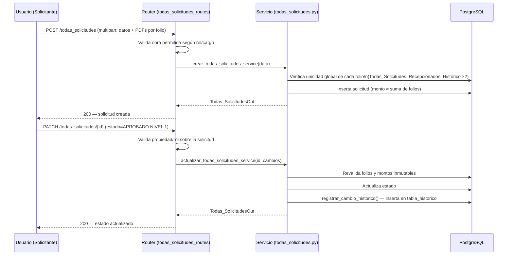

# Documentación Técnica — FlujoPago

Documentación de arquitectura, estructura del proyecto, componentes internos y flujo de datos de FlujoPago, orientada a desarrolladores que se incorporan al mantenimiento del sistema.

---

## Tabla de Contenido

- [Visión Arquitectónica](#visión-arquitectónica)
- [Estructura del Proyecto](#estructura-del-proyecto)
- [Capa de Dominio](#capa-de-dominio)
- [Capa de Infraestructura](#capa-de-infraestructura)
- [Capa de Interfaz](#capa-de-interfaz)
- [Middlewares y Orden de Ejecución](#middlewares-y-orden-de-ejecución)
- [Ciclo de Vida de la Aplicación](#ciclo-de-vida-de-la-aplicación)
- [Modelo de Datos y Migraciones](#modelo-de-datos-y-migraciones)
- [Flujo de una Solicitud de Pago](#flujo-de-una-solicitud-de-pago)
- [Control de Visibilidad por Rol, Cargo y Obra](#control-de-visibilidad-por-rol-cargo-y-obra)
- [Manejo de Archivos PDF](#manejo-de-archivos-pdf)
- [Paginación](#paginación)
- [Logging](#logging)
- [Decisiones de Diseño y Deuda Técnica Conocida](#decisiones-de-diseño-y-deuda-técnica-conocida)

---

## Visión Arquitectónica

FlujoPago implementa **Arquitectura Hexagonal (Ports & Adapters)**: la lógica de negocio (capa `domain`) no depende de FastAPI, SQLAlchemy ni de ningún detalle de infraestructura. Los adaptadores primarios (`interfaces`, la API REST) y secundarios (`infrastructure`, base de datos/correo/caché) rodean al dominio y pueden sustituirse sin modificar las reglas de negocio.

```
┌─────────────────────────────────────────────────────────────┐
│                        interfaces/                          │
│         (Adaptadores primarios — entrada al sistema)         │
│              routers FastAPI · templates Jinja2               │
└───────────────────────────┬───────────────────────────────────┘
                            │ invoca
┌───────────────────────────▼───────────────────────────────────┐
│                          domain/                               │
│         (Núcleo — reglas de negocio, independiente de FastAPI)  │
│        models · services · dto · schemas de respuesta            │
└───────────────────────────┬───────────────────────────────────┘
                            │ usa
┌───────────────────────────▼───────────────────────────────────┐
│                       infrastructure/                           │
│        (Adaptadores secundarios — detalles técnicos)             │
│   db (PostgreSQL) · security (JWT/MFA/Redis) · mailing (SMTP)      │
│              middleware · utils · repositories                     │
└─────────────────────────────────────────────────────────────────┘
```

No existe una capa `application/` desarrollada con orquestadores de casos de uso explícitos (patrón CQRS/UseCase) — actualmente `application/` está vacía y la orquestación de cada caso de uso vive directamente en los `services` del dominio, invocados desde los routers de `interfaces`.

---

## Estructura del Proyecto

```
FlujoPago/
├── app/
│   ├── core/                     # Configuración central (reservado)
│   ├── application/              # Reservado para orquestación de casos de uso (actualmente vacío)
│   ├── domain/
│   │   ├── models/                # Entidades ORM SQLAlchemy (una por tabla)
│   │   ├── services/               # Reglas de negocio (usuarios, solicitudes, 2FA, empresas...)
│   │   ├── dto/                     # Modelos Pydantic v2 de entrada/salida por router
│   │   └── schemas/                  # APIResponse genérico (contrato de respuesta)
│   ├── infrastructure/
│   │   ├── db/                        # Motor async, migraciones idempotentes, seed
│   │   ├── security/                   # JWT, hashing, MFA, guards de rol, Redis
│   │   ├── mailing/                     # Servicio SMTP asíncrono y plantillas HTML
│   │   ├── middleware/                   # MFA gate, errores, CORS, cabeceras, formato de respuesta
│   │   ├── utils/                         # Logger, validaciones, PDF, paginación, response wrapper
│   │   └── repositories/                   # Reservado para repositorios explícitos (actualmente vacío)
│   ├── interfaces/
│   │   ├── api/
│   │   │   ├── routers/                     # 14 routers FastAPI (ver API_DOCUMENTATION.md)
│   │   │   └── templates/                    # Vistas Jinja2 (login, dashboard, mfa, force-change)
│   │   └── dependencies/                       # Reservado (actualmente vacío)
│   ├── tests/                                  # Suite pytest unitaria (BD mockeada)
│   └── main.py                                  # Punto de entrada: middlewares, routers, lifespan
│
├── public/                       # Frontend estático: CSS, JS, imágenes
├── doc_pdf/ · PDF_firmados/ · PDF_autorizaciones/    # Almacenamiento de adjuntos (creado en runtime)
├── logs/                          # Logs rotados de la aplicación
├── backups/db/                     # Volcados locales de PostgreSQL
├── scripts/backup_s3.sh              # Plantilla de respaldo a AWS S3
├── .github/workflows/                  # Pipeline de auditoría de dependencias (CI/CD de seguridad)
├── Dockerfile · docker-compose.yml       # Build e infraestructura
├── requirements.txt                       # Dependencias de Python (producción)
├── requirements-dev.txt                   # pytest + pytest-asyncio (obligatorio para la suite)
├── tests/integration/                     # Suite de integración REAL (PostgreSQL + Redis efímeros)
├── scripts/run_backend_tests.sh           # Ejecuta unitarias + integración en Docker aislado
└── test_trusted_device.py, verify_error_masking.py, test_duplicates_local.py
                                              # Scripts de verificación manual end-to-end
```

> Los directorios `application/`, `repositories/` y `dependencies/` existen como parte del esqueleto de la arquitectura hexagonal pero no contienen lógica activa en el estado actual del proyecto — la orquestación y el acceso a datos se realiza directamente desde `domain/services` usando la sesión de SQLAlchemy inyectada.

---

## Capa de Dominio

### Modelos (`domain/models/`)

Entidades SQLAlchemy 2.0 (declarative, `Base` compartida). Todos deben importarse explícitamente en `app/main.py` antes de `init_db()` para que SQLAlchemy los registre en `Base.metadata`:

| Modelo | Tabla | Rol |
| --- | --- | --- |
| `tabla_usuarios.py` | `usuarios` | Usuario con credenciales, rol, cargo, empresa y estado de MFA |
| `tabla_dispositivos_confianza.py` | `dispositivos_confianza` | Dispositivos con bypass de 2FA vigente |
| `tabla_roles.py` | `roles` | Catálogo de roles |
| `tabla_empresas.py` | `empresas` | Empresas del grupo (en el seed: ANDES, CORDILLERA, PACIFICO) |
| `tabla_procesos.py` | `procesos` | Catálogo de procesos financieros |
| `tabla_procesos_auxiliares.py` | `procesos_auxiliares` | Obras / unidades de negocio |
| `tabla_usuarios_obras.py` | `usuarios_obras` | Relación N:M usuario ↔ obra asignada |
| `tabla_todas_solicitudes.py` | `tabla_todas_solicitudes` | Registro central de solicitudes activas |
| `tabla_recepcionados.py` | `tabla_recepcionados` | Solicitudes devueltas al solicitante |
| `tabla_historico.py` | `tabla_historico` | Auditoría de cambios de estado |

### Servicios (`domain/services/`)

Contienen la lógica de negocio pura, parametrizada con la sesión async de SQLAlchemy que reciben los routers:

| Servicio | Responsabilidad |
| --- | --- |
| `usuario_service.py` | Creación de usuarios, generación de contraseñas temporales (`generar_password_temporal`) |
| `two_factor.py` | Generación/verificación TOTP, cifrado Fernet, backup codes, QR |
| `todas_solicitudes.py` | Unicidad global de folios, cálculo de montos, registro automático en histórico |
| `recepcionado_service.py` | Conversión y reenvío de solicitudes recepcionadas |
| `historico_service.py` | Consultas de auditoría y estadísticas |
| `empresa_service.py`, `procesos_service.py`, `proceso_auxiliares_service.py` | CRUD de datos maestros |
| `documentos_flujo_service.py` | PDF firmado / de autorización: parseo de IDs, tabla de `origen` y emparejamiento con el histórico por id + folio |

### DTOs (`domain/dto/`)

Modelos Pydantic v2 que validan entrada/salida por router (`usuariosDTO.py`, `mfaDTO.py`, `todas_solicitudesDTO.py`, `recepcionadoDTO.py`, `historicoDTO.py`, `empresasDTO.py`, `rolesDTO.py`, `procesosDTO.py`, `procesos_auxiliaresDTO.py`, `LoginDTO.py`). Los validadores de campo reutilizan las funciones centralizadas de `infrastructure/utils/validaciones.py` (nombre, RUT, email, password, longitud de campos).

### Esquema de respuesta (`domain/schemas/response_schemas.py`)

Define `APIResponse[T]` (genérico Pydantic) y `ErrorDetail`, usados solo como contrato documental en OpenAPI — la construcción real de cada respuesta ocurre en `infrastructure/utils/response_wrapper.py` y, de forma transparente para el handler, en `ResponseWrapperMiddleware`.

---

## Capa de Infraestructura

### Base de datos (`infrastructure/db/database.py`)

- Motor async (`create_async_engine`, driver `asyncpg`) con pool configurable (`DB_POOL_SIZE`, `DB_MAX_OVERFLOW`), `pool_pre_ping=True` y `pool_recycle=1800` segundos.
- `init_db()` crea las tablas (`Base.metadata.create_all`) y aplica un conjunto de migraciones **idempotentes** escritas en SQL crudo (`ALTER TABLE ... ADD COLUMN IF NOT EXISTS`, `CREATE TABLE IF NOT EXISTS`) para evolucionar el esquema sin herramienta de migraciones dedicada (no se usa Alembic). Entre estas se crea `db_initialization_log`, tabla de control (`key` PK + `initialized_at`) que garantiza que `db_seed.py` se ejecute una única vez.
- `db_seed.py` siembra datos maestros y usuarios por defecto. Antes de sembrar, consulta `db_initialization_log` por la clave `db_seed_executed`: si existe, omite el seed; si no existe pero `roles`/`usuarios` ya tienen filas (adopción de una base de datos preexistente), registra la inicialización retroactivamente sin volver a insertar datos. El usuario Super Administrador se crea con el email/contraseña de `SEED_SUPER_ADMIN_EMAIL`/`SEED_SUPER_ADMIN_PASSWORD`; si la contraseña no está definida se genera una aleatoria y se informa una vez en el log (no hay contraseña por defecto en el código). Ya no se siembra ningún usuario de prueba. `desactivar_credenciales_de_prueba()` se ejecuta en cada arranque y deja inutilizable la antigua cuenta de prueba `casa2301teo@gmail.com` si conserva la contraseña publicada.

### Seguridad (`infrastructure/security/`)

| Archivo | Responsabilidad |
| --- | --- |
| `jwt_handler.py` | Creación/verificación de JWT (HS256), duración de access/refresh token |
| `hashing.py` | Argon2id para contraseñas y backup codes |
| `auth.py` | Servicio de login (validación de credenciales) |
| `auth_token_roles.py` | Dependencias FastAPI: `get_current_user`, `require_admin`, `require_role` |
| `mfa_dependency.py` | `MFAMiddleware` — gate de cambio de contraseña y verificación 2FA por request |
| `redis_service.py` | Rate limiting de login/2FA, almacenamiento de OTP por correo |
| `permisos.py` | Reglas de autorización por registro: alta visibilidad, gestión, recepción, propiedad (incl. homónimos) y transiciones de estado permitidas al dueño |
| `dependencia_token.py` | Dependencia alternativa basada en `HTTPBearer` que consulta la BD directamente; no está enlazada a ningún router activo actualmente |

### Correo (`infrastructure/mailing/email_service.py`)

Envío asíncrono vía `aiosmtplib`, con inlining de CSS (`premailer`) para compatibilidad entre clientes de correo, soporte de imágenes embebidas (usado para el QR de 2FA) y una whitelist de dominios de destino (`ALLOWED_EMAIL_DOMAINS`) que se aplica a **todo** correo saliente del sistema.

### Middlewares (`infrastructure/middleware/`)

Ver [Middlewares y Orden de Ejecución](#middlewares-y-orden-de-ejecución).

### Utilidades (`infrastructure/utils/`)

| Archivo | Responsabilidad |
| --- | --- |
| `logger_personalizado.py` | Logger con salida a consola (coloreada) y archivo rotado |
| `validaciones.py` | Validadores reutilizables: password, RUT, email corporativo, nombres, longitudes |
| `pdf_utils.py` | Sanitización de nombres, optimización con `pikepdf`, guardado y borrado de adjuntos |
| `pagination_utils.py` | Paginación uniforme: sin `limit` retorna todo (tope `LISTADO_MAX_REGISTROS`), con `limit` recorta a `max_limit`; negativos → 422 |
| `response_wrapper.py` | Constructores `success_response` / `error_response` |

---

## Capa de Interfaz

### Routers (`interfaces/api/routers/`)

14 routers FastAPI, todos bajo el prefijo `/flujopago/gestion-pagos/v1`, registrados explícitamente en `app/main.py`. El detalle completo de endpoints está en [DOC_API_DOCUMENTATION.md](DOC_API_DOCUMENTATION.md); a nivel arquitectónico, cada router:

1. Declara sus dependencias de autenticación (`get_current_user` / `require_admin`) directamente en la firma de cada endpoint.
2. Aplica reglas de visibilidad adicionales (por rol/cargo/obra) **dentro del cuerpo del handler**, no como dependencias reutilizables — es decir, la autorización granular de negocio (p. ej. "un Solicitante solo ve sus propias solicitudes") vive en el router, no en un middleware ni en una capa de políticas centralizada.
3. Delega la lógica de negocio real al `domain/service` correspondiente.

### Templates (`interfaces/api/templates/`)

Vistas HTML renderizadas server-side con Jinja2 (login, dashboard, `mfa.html`, `force-change`, plantillas de error). El frontend se apoya en JavaScript nativo (`public/JS/`) y Tailwind CSS, sin frameworks de componentes.

Tras la reorganización de diseño, cada plantilla delega su lógica de comportamiento y su configuración de Tailwind a archivos dedicados en `public/JS/` (p. ej. `mfa.js`/`mfa_tailwind.js`, `force_change.js`/`force_change_tailwind.js`, `dashboard_navbar.js`/`dashboard_tailwind.js`, `index_tailwind.js`) y las plantillas de error (`error_403.html`, `error_404.html`, `error_422.html`, `error_500.html`) tienen su propia hoja de estilos en `public/CSS/` (`error_403.css`, `error_404.css`, `error_422.css`, `error_500.css`) y su propio script (`error_401.js` … `error_500.js`), en vez de CSS/JS embebido inline en el HTML.

---

## Middlewares y Orden de Ejecución

Registrados en `app/main.py` con `app.add_middleware(...)`. Starlette ejecuta los middlewares en **orden inverso al de registro** para las requests entrantes (el último añadido es el más externo):

```
Orden de registro en main.py:
  1. MFAMiddleware
  2. ResponseWrapperMiddleware
  3. ErrorMiddleware
  4. GZipMiddleware
  5. SecurityHeadersMiddleware
  6. CustomCORSMiddleware

Orden real de ejecución para una request entrante:
  CustomCORSMiddleware → SecurityHeadersMiddleware → GZipMiddleware
      → ErrorMiddleware → ResponseWrapperMiddleware → MFAMiddleware → router
```

| Middleware | Función |
| --- | --- |
| `CustomCORSMiddleware` | Aplica política CORS con orígenes configurables por `CORS_ALLOWED_ORIGINS` |
| `SecurityHeadersMiddleware` | Agrega CSP, HSTS, X-Frame-Options, X-Content-Type-Options, Referrer-Policy, Permissions-Policy a toda respuesta |
| `GZipMiddleware` | Compresión de respuestas mayores a 1000 bytes (middleware estándar de Starlette) |
| `ErrorMiddleware` | Normaliza excepciones y códigos de error HTTP; enmascara mensajes de excepciones no controladas en rutas de API; renderiza plantillas HTML de error en rutas no-API |
| `ResponseWrapperMiddleware` | Envuelve toda respuesta JSON 2xx que aún no tenga el formato estándar (`status`/`timestamp`/...), preservando cabeceras `Set-Cookie` |
| `MFAMiddleware` | Aplica el gate de cambio de contraseña obligatorio y verificación 2FA antes de permitir el acceso a recursos protegidos |

---

## Ciclo de Vida de la Aplicación

Gestionado por el context manager `lifespan` de FastAPI en `app/main.py`:

```python
async def lifespan(app: FastAPI):
    await init_db()     # Crea tablas + migraciones idempotentes
    await seed_data()   # Siembra datos maestros si las tablas están vacías
    await desactivar_credenciales_de_prueba()  # Neutraliza cuentas de prueba con clave publicada
    await init_redis()  # Inicializa el cliente Redis
    yield
    await close_redis()
    await close_db()
```

No existe un paso de migración manual separado del arranque: cada `docker-compose up` o cada reinicio del proceso vuelve a ejecutar `init_db()`/`seed_data()`, que están diseñados para ser seguros de repetir (idempotentes).

---

## Modelo de Datos y Migraciones

El esquema completo de tablas está documentado en el [README](README.md#️-modelo-de-datos). A nivel técnico:

- **Sin herramienta de migraciones dedicada**: no se usa Alembic ni similar. La evolución del esquema se gestiona con sentencias `ALTER TABLE`/`CREATE TABLE` condicionales dentro de `init_db()`, ejecutadas en cada arranque.
- **Implicación para el equipo de desarrollo**: cualquier cambio de esquema debe añadirse como una nueva sentencia idempotente en `database.py`, documentando claramente qué migración representa, en lugar de modificar directamente la definición del modelo ORM (que por sí sola no altera tablas ya existentes en una base de datos preexistente).
- **Relaciones clave**: `usuarios` → `roles`/`empresas` (N:1), `usuarios` → `dispositivos_confianza` (1:N), `usuarios` ↔ `procesos_auxiliares` a través de `usuarios_obras` (N:M), y `tabla_todas_solicitudes`/`tabla_recepcionados`/`tabla_historico` comparten la mayoría de sus columnas de negocio pero son tablas independientes (no hay una jerarquía de herencia ORM entre ellas).

---

## Flujo de una Solicitud de Pago



Puntos clave de diseño:

- El `monto` total de una solicitud se **recalcula siempre** como la suma de los montos por folio (no negativos); el valor enviado por el cliente en ese campo se ignora para el cálculo final.
- El monto original de una solicitud es **inmutable**: `PATCH` ignora `monto` y la suma de los folios modificados nunca puede exceder el monto con el que se creó la solicitud.
- **El backend aplica el flujo, no solo la UI**: un usuario sin rol de gestión solo crea en `ESPERANDO`/`PENDIENTE` y, como dueño, solo ejecuta las transiciones de "enviar/reenviar" y "modificar y reenviar" (`transicion_permitida_para_dueno` en `permisos.py`). Aprobar niveles, Finanzas, recepción (`POST /recepcionado`) y pago son exclusivos de los roles del flujo.
- Cada cambio de `estado` en una solicitud dispara automáticamente un registro en `tabla_historico` — no existe un paso de "aprobación" separado de la actualización genérica vía `PATCH`.
- **No existe un endpoint de aprobación masiva** (`bulk`); el cambio de estado se realiza una solicitud a la vez. Una función de "aprobar varias" en la interfaz se traduce en múltiples llamadas `PATCH` individuales desde el cliente.

---

## Control de Visibilidad por Rol, Cargo y Obra

La autorización de FlujoPago combina tres dimensiones. Las reglas a nivel de registro están centralizadas en `app/infrastructure/security/permisos.py` (auditoría nov-2026); las dependencias de rol (`require_admin`) siguen en los routers:

1. **Rol** (`Administrador`, `Solicitante`, `Aprobador`, `Responsable Finanzas`) — controla operaciones de escritura administrativas vía `require_admin`.
2. **Cargo** (`CargosDisponibles`: Jefe de Recursos Humanos, Subgerente de Capital Humano, Analista de Personal, Jefe de Finanzas, Administrador) — se usa junto al rol para decidir si un usuario tiene visibilidad ampliada sobre solicitudes/recepcionados de terceros.
3. **Obra asignada** (`usuarios_obras`) — para roles/cargos sin visibilidad ampliada, filtra qué solicitudes puede ver y en qué obras puede crear nuevas solicitudes; un usuario sin obras asignadas no ve ningún registro en los listados filtrados.

Principio aplicado: **un usuario solo actúa sobre lo que puede ver o modificar por `PATCH`**. Las 5 rutas de histórico aplican el mismo filtro de alcance (`_condiciones_alcance`), y los PDFs, la conversión/reenvío de recepcionados y los documentos del flujo exigen la misma autorización que la modificación del registro.

**Propiedad por nombre (retrocompatibilidad):** un registro es "propio" por `usuario_id`, o por nombre completo coincidente **salvo** que su `usuario_id` sea de otra persona con el mismo nombre (homónimo). La coincidencia por nombre se mantiene para registros heredados sin `usuario_id` o cargados por terceros (p.ej. recepcionados antiguos guardados con el `usuario_id` de Finanzas). Implementado en Python (`es_dueno_verificado`) y en SQL para los listados (`condicion_propiedad`).

---

## Manejo de Archivos PDF

- **Sanitización de nombres**: normalización Unicode (NFKD), remoción de acentos y caracteres no alfanuméricos antes de guardar cualquier archivo.
- **Nombrado único**: cada PDF se guarda como `{folio}_{nombre_sanitizado}_{uuid4}.pdf`, evitando colisiones incluso con folios o nombres de archivo repetidos. La extensión es **siempre `.pdf`** (antes se conservaba la del cliente; un `.html` se servía como página → XSS).
- **Optimización**: `pikepdf` linealiza y recomprime cada PDF al guardarlo; si el archivo no puede procesarse (PDF corrupto), se guarda sin optimizar como fallback antes de fallar definitivamente.
- **Carpetas de destino**: `doc_pdf/` (solicitudes/recepcionados), `PDF_firmados/` (firma de documentos), `PDF_autorizaciones/` (registro de autorización) — coinciden exactamente con la whitelist de carpetas servidas por el router de descarga.
- **Descarga protegida**: el router de descarga resuelve la ruta absoluta del archivo solicitado y verifica que permanezca dentro de la carpeta permitida antes de servirlo, evitando *path traversal*. Solo los PDF se sirven `inline`; cualquier otro tipo se entrega como `attachment` binario.
- **Sin huérfanos en rechazos**: si la creación de una solicitud falla tras guardar los PDF (folio duplicado, validación), los archivos se eliminan.
- **PDF firmado / de autorización**: se aplican solo a la tabla indicada por `origen` (`solicitud` por defecto) y al histórico emparejado por id **y** folio — las tablas de solicitudes y recepcionados tienen secuencias de ID independientes.
- **Sin límite de tamaño explícito**: no hay una validación de tamaño máximo de archivo a nivel de aplicación; el único control de tipo es la verificación de `content_type == application/pdf` (presente en los endpoints de adjunto individual, pero no aplicada de forma consistente en la carga inicial multipart de una solicitud).

---

## Paginación

`paginate_query()` (`infrastructure/utils/pagination_utils.py`) se usa en todos los routers de listado. Si el cliente no envía `limit`/`offset` (caso del frontend, que no pagina) se retornan **todos** los registros con orden determinista (clave primaria, salvo que la consulta ya defina un orden), hasta el tope de seguridad `LISTADO_MAX_REGISTROS` (10 000 por defecto); si se alcanza, se registra una advertencia. Antes se truncaba silenciosamente a 200 filas sin `ORDER BY`. Con paginación explícita, `limit` se recorta a `max_limit` (200, o 500 en histórico); valores negativos responden `422`. El total de registros (`total_count`) se calcula internamente para fines de logging, pero **no se expone actualmente en el cuerpo de la respuesta al cliente** (no hay metadatos de `total`/`has_next` en el JSON).

---

## Logging

`setup_logger()` (`infrastructure/utils/logger_personalizado.py`) configura, por módulo, un logger con:

- Salida a consola con color por nivel (DEBUG/INFO/WARNING/ERROR/CRITICAL).
- Salida a archivo con rotación (`logs/app.log`, máximo 5 MB por archivo, hasta 5 archivos de respaldo).
- Formato uniforme: `AAAA-MM-DD HH:MM:SS | NIVEL | NOMBRE_MODULO | ---> mensaje`.

Cada módulo relevante instancia su propio logger con un nombre identificable (`"MAIN"`, `"DATABASE"`, `"DB_SEED"`, `"REDIS_SERVICE"`, etc.), lo que facilita filtrar el origen de un mensaje en producción.

---

## Decisiones de Diseño y Deuda Técnica Conocida

Documentadas aquí de forma transparente para quien continúe el mantenimiento del proyecto:

- **Sin Alembic**: las migraciones son SQL idempotente embebido en `database.py`. Funciona bien a la escala actual, pero dificulta el versionado explícito de cambios de esquema a medida que el proyecto crezca.
- **Autorización parcialmente centralizada**: las reglas por registro viven en `permisos.py`, pero los filtros de los listados (`GET /todas_solicitudes`, `/recepcionado`, `/historico`) todavía construyen sus consultas dentro de cada router.
- **JWT sin revalidación contra BD** (H-15, pendiente): los claims de rol/cargo se leen del token, no de la base de datos, en cada request; un cambio de rol, un restablecimiento de contraseña o la eliminación del usuario solo tienen efecto cuando el token expira (24 h).
- **Unicidad de folio sin restricción en BD** (H-08, pendiente): se valida con un `SELECT` previo; dos altas simultáneas con el mismo folio pueden registrarse ambas.
- **`/mfa/disable` sin rate limit** (H-16, pendiente).
- **`refresh_token` emitido pero sin endpoint de renovación**: la infraestructura para tokens de refresco existe (`create_refresh_token`), pero no hay un endpoint `/refresh` implementado — el `access_token` dura 24 horas y, al expirar, el usuario debe volver a iniciar sesión.
- **Dependencia alternativa no utilizada**: `dependencia_token.py` define un mecanismo de autenticación basado en `HTTPBearer` que sí consulta la base de datos, pero ningún router activo lo usa actualmente.
- **Sin límite de tamaño de archivo**: los endpoints de carga de PDF no validan un tamaño máximo explícito.
- **Lista blanca de emails de prueba**: `validate_corporate_email` acepta emails fuera de los dominios corporativos definidos en `EMAILS_PRUEBA_PERMITIDOS` (por defecto, la lista histórica). En producción debe configurarse vacía.
- **Excepción del Super Administrador al cambio forzado de contraseña**: la cuenta identificada por `SEED_SUPER_ADMIN_EMAIL` está exceptuada de `must_change_password` en `MFAMiddleware`, `dashboard_routes.py` y `GET /mfa/status` — la comparación se hace por email en cada punto en vez de un flag centralizado, por lo que cualquier cambio a esta regla debe replicarse en los tres lugares.

## Pruebas

| Suite | Ubicación | Qué valida |
| --- | --- | --- |
| Unitaria | `app/tests/` (79 tests) | Rutas con sesión de BD mockeada; requiere `pytest-asyncio` |
| Integración real | `tests/integration/` (≈270 casos) | App completa contra PostgreSQL y Redis efímeros: permisos, aislamiento por usuario/obra, persistencia, rollback, archivos en disco, Redis y regresión de cada hallazgo de la auditoría |

Ejecución: `scripts/run_backend_tests.sh [unit|integration]`. La suite de integración se niega a correr si el nombre de la BD no contiene `test`, trunca y re-siembra un dataset determinista en cada test y elimina los PDF que crea. Los hallazgos aún no corregidos tienen tests `xfail(strict=True)`: si alguien los corrige, el test pasa a XPASS y obliga a actualizar la suite. El informe completo está en [docs/AUDITORIA_ENDPOINTS_2026-11.md](docs/AUDITORIA_ENDPOINTS_2026-11.md).

---

Para el detalle de seguridad específico de autenticación, 2FA y dispositivos de confianza, consulta [DOC_SPECIAL_FEATURES.md](DOC_SPECIAL_FEATURES.md).
