<div align="center">


# FlujoPago

**Solicitudes de pago con aprobaciones por etapas, para equipos de RRHH, Capital Humano y Finanzas.**

Reemplaza el ir y venir de correos y planillas por un flujo único: quien solicita registra el pago con sus respaldos en PDF,
RRHH y Capital Humano lo aprueban o lo devuelven con un comentario, y Finanzas lo procesa. Cada paso queda registrado.
Es una plataforma de gestión de pagos para un grupo de empresas (en los datos de ejemplo: ANDES, CORDILLERA y PACIFICO).

[](https://www.python.org/)
[](https://fastapi.tiangolo.com/)
[](https://react.dev/)
[](https://www.typescriptlang.org/)
[](https://www.postgresql.org/)

[](https://redis.io/)
[](https://docs.docker.com/compose/)
[](#-seguridad)
[](#-calidad-y-pruebas)
[](https://playwright.dev/)
[](#-limitaciones-conocidas-y-próximos-pasos)

[El proyecto](#-el-proyecto-en-30-segundos) ·
[Capturas](#-capturas) ·
[Funcionalidades](#-funcionalidades) ·
[Tecnología](#-tecnología) ·
[Diagramas](#-mapas-del-sistema) ·
[Instalación](#-instalación) ·
[Manual de uso](#-manual-de-uso) ·
[Seguridad](#-seguridad) ·
[Preguntas](#-preguntas-frecuentes)

</div>

---

## 🎯 El proyecto en 30 segundos

| | |
|---|---|
| **El problema** | Los pagos al personal (remuneraciones, finiquitos, anticipos, préstamos) necesitan varias firmas. Por correo se pierden respaldos, nadie sabe en qué etapa está una solicitud y los folios se duplican. |
| **La solución** | Una aplicación web donde cada solicitud avanza por etapas visibles: **Pendiente → Aprobado nivel 1 (RRHH) → Aprobado nivel 2 (Capital Humano) → Aprobado Finanzas → Recepcionado**. Si algo falta, se devuelve con un comentario. |
| **Para quién** | Analistas que solicitan pagos, jefaturas de RRHH y Capital Humano que aprueban, Finanzas que procesa y un administrador que gestiona usuarios y catálogos. |
| **Seguridad** | Cuentas creadas solo por el administrador, cambio de contraseña obligatorio en el primer ingreso, verificación en dos pasos para todos y bloqueo tras intentos fallidos. |
| **Alcance** | 11 secciones en la interfaz, 58 servicios de API, 3 empresas, 4 roles con permisos distintos y reportes en Excel. Se adapta desde móviles hasta monitores 4K. |

> [!IMPORTANT]
> **Herramienta multiusuario de uso interno.** Cada persona entra con su propia cuenta corporativa (`@flujopago.cl` o `@grupodemo.cl`)
> y solo ve las secciones de su rol. Las cuentas no se pueden autorregistrar: las crea el administrador, que además asigna las obras
> (unidades de negocio) que cada usuario puede ver.

---

## 📸 Capturas

> Todas las imágenes usan **datos ficticios** (empresas, personas, folios y montos inventados), capturados con Playwright sobre el backend real y una base de datos efímera de demostración. Para regenerarlas: `scripts/capturar_screenshots.sh` (requiere Docker y `frontend/dist`).

<table>
  <tr>
    <td width="50%">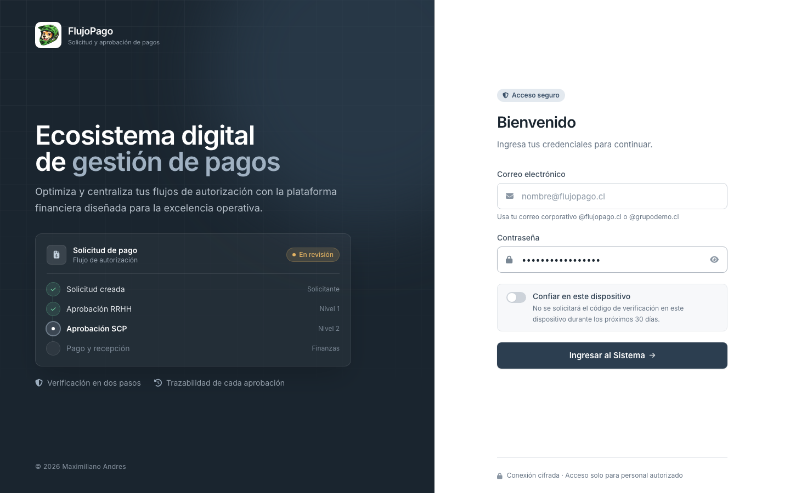<br /><b>Inicio de sesión</b>: acceso con correo corporativo y opción de confiar en el dispositivo.</td>
    <td width="50%">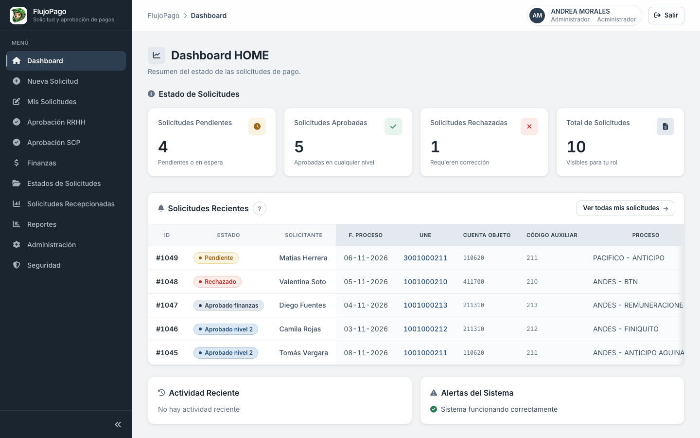<br /><b>Dashboard</b>: solicitudes pendientes, aprobadas y rechazadas, más las recientes.</td>
  </tr>
  <tr>
    <td>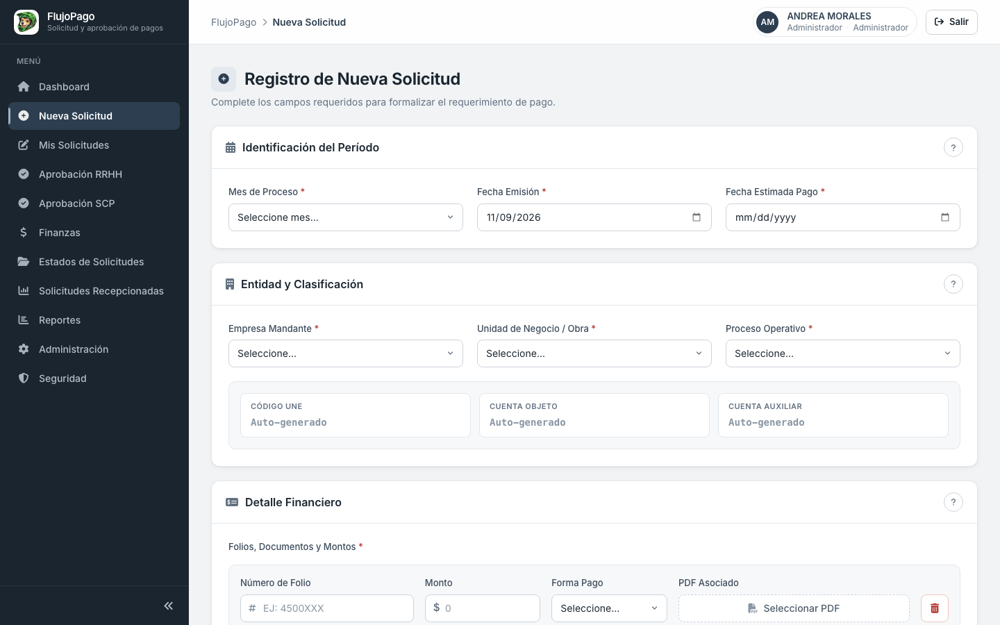<br /><b>Nueva solicitud</b>: período, empresa, obra, proceso y hasta 5 folios con su PDF.</td>
    <td>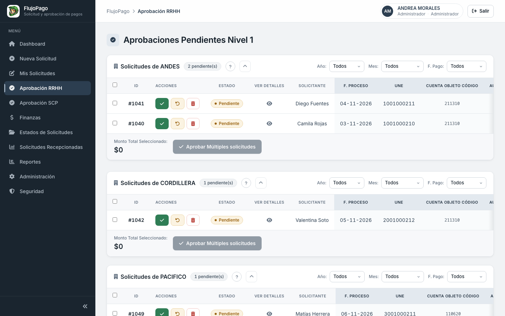<br /><b>Aprobación RRHH</b>: bandeja por empresa con aprobación individual o múltiple.</td>
  </tr>
  <tr>
    <td>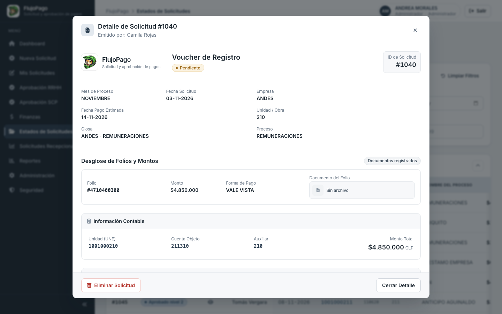<br /><b>Detalle</b>: voucher con folios, montos e información contable.</td>
    <td align="center">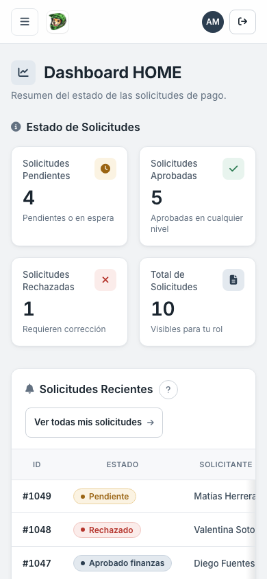<br /><b>Vista móvil</b>: la misma interfaz, adaptada a pantallas pequeñas.</td>
  </tr>
</table>

---

## ✨ Funcionalidades

### Para el usuario de negocio

| | Funcionalidad | Qué permite hacer |
|---|---|---|
| 📝 | Nueva solicitud | Registrar, por ejemplo, el pago de remuneraciones de noviembre de la obra 210 con sus folios, montos y PDF de respaldo. |
| 🔁 | Aprobación en dos niveles | El Jefe de RRHH aprueba primero y el Subgerente de Capital Humano después. Ambos pueden aprobar varias solicitudes a la vez. |
| ↩️ | Devolución con comentario | Si falta un respaldo, la solicitud vuelve a quien la creó con el motivo, y esa persona la corrige con **Editar y Reenviar**. |
| 💵 | Finanzas | Procesar las solicitudes aprobadas, adjuntar los PDF firmados y exportar a Excel lo aprobado por Finanzas. |
| 🔎 | Estados de solicitudes | Buscar por ID, solicitante o empresa y filtrar por estado, fechas y rango de montos. |
| 📊 | Reportes | Descargar en Excel un reporte general, uno histórico y uno de recepcionados, filtrados por año, mes, estado y empresa. |
| 🗂️ | Solicitudes recepcionadas | Consultar lo que Finanzas ya procesó y reingresar un registro al flujo con **Guardar como Nueva Solicitud**. |
| 🛡️ | Seguridad de la cuenta | Ver los dispositivos de confianza y revocarlos cuando quieras. |
| ❔ | Ayuda integrada | Botones **?** junto a cada sección del formulario y cada tabla, que explican qué significa cada campo o columna. |

### Para el perfil técnico

| | Funcionalidad | Detalle técnico |
|---|---|---|
| 🏗️ | Backend por capas | FastAPI con `domain` / `infrastructure` / `interfaces`, 15 routers y 58 endpoints REST bajo `/flujopago/gestion-pagos/v1`. |
| ⚛️ | SPA en React | React 19 + TypeScript + Vite, servida por FastAPI en `/flujopago/gestion-pagos/v1/app/`. Rutas y secciones con carga diferida (`lazy`). |
| 🔐 | Sesión sin token en JS | JWT en cookie `httpOnly` + `SameSite=lax`. React no almacena el token y obtiene el usuario desde `GET /session`. |
| 🔑 | 2FA obligatorio | TOTP (RFC 6238) con secreto cifrado con Fernet, código alternativo por correo y códigos de respaldo hasheados con Argon2. |
| 🧾 | Folio único global | Validación en el servicio contra solicitudes activas, recepcionadas e históricas antes de guardar. |
| 📄 | PDF optimizados | `pikepdf` optimiza cada adjunto. La descarga pasa por endpoints autenticados con protección contra *path traversal*. |
| 🕓 | Histórico automático | Cada cambio de estado se registra en `tabla_historico`, consultable por solicitud, estado o solicitante. |
| 📦 | Respuesta uniforme | Un middleware envuelve todo JSON en `{ status, code, message, data, ... }` y enmascara los errores internos. |
| ♻️ | Caché en el cliente | TanStack Query precarga las solicitudes en paralelo con el código de la sección e invalida tras cada acción. |

---

## 🧰 Tecnología

| Capa | Tecnología | Uso en el proyecto |
|---|---|---|
| Frontend | React 19.2 · TypeScript 5.9 · Vite 8.3 | Interfaz de una sola página (SPA) |
| Estilos | Tailwind CSS 3.4 · tokens CSS propios | Sistema de diseño claro/oscuro, responsive de móvil a 4K |
| Datos en el cliente | TanStack Query 5.106 · React Router 7.18 | Caché de consultas y navegación |
| Exportación | xlsx-js-style 1.2 | Reportes Excel con formato, cargado solo al exportar |
| Backend | Python 3.11 · FastAPI 0.104.1 · Uvicorn 0.24 | API REST y servidor ASGI |
| Validación | Pydantic 2.5 | DTO de entrada y salida |
| Persistencia | PostgreSQL 16 · SQLAlchemy 2.0.23 (async) · asyncpg 0.29 | Base de datos y ORM asíncrono |
| Sesiones y límites | Redis 7 · redis-py 5.0.1 | Bloqueo por intentos, OTP por correo, estado temporal de 2FA |
| Seguridad | PyJWT 2.10.1 · argon2-cffi 23.1 · pyotp 2.9 · cryptography 42.0.5 | Tokens, hashing, TOTP y cifrado |
| Documentos | pikepdf 8.11.2 | Optimización de PDF |
| Correo | aiosmtplib 3.0.1 · premailer 3.10 | Envío asíncrono de códigos y contraseñas temporales |
| Pruebas | pytest · Vitest 5.1 · Testing Library 16.3 · Playwright 1.65 | Backend, componentes y E2E contra el stack real |
| Operación | Docker Compose · GitHub Actions | Servicios, respaldo diario y auditoría de dependencias |

**Competencias técnicas que demuestra**

- **Arquitectura y patrones**: separación en capas (`domain`, `infrastructure`, `interfaces`), middlewares encadenados (2FA, errores, formato de respuesta, cabeceras) y frontend organizado por funcionalidad (`features/`) con la lógica en módulos puros probados aparte.
- **Seguridad aplicada**: JWT en cookie `httpOnly`, 2FA obligatorio con tres vías de verificación, Argon2, cifrado Fernet, bloqueo por intentos con Redis, CSP estricta para la SPA y control de roles en el servidor.
- **Rendimiento**: consultas asíncronas, compresión GZip, PDF optimizados con descarga por *streaming*, división del código por sección y precarga de datos en paralelo.
- **UX y accesibilidad**: diseño responsive verificado de 320 px a 3840 px, tema oscuro por preferencia del sistema, foco visible por teclado, áreas táctiles de 44 px y ayuda contextual.
- **Ingeniería de software**: 307 casos de prueba en tres niveles, E2E en 5 perfiles de navegador (incluidos Pixel 7 e iPhone 14), tipado estricto, ESLint y un pipeline diario de auditoría de dependencias.

---

## 🧭 Mapas del sistema

### 1. Arquitectura general

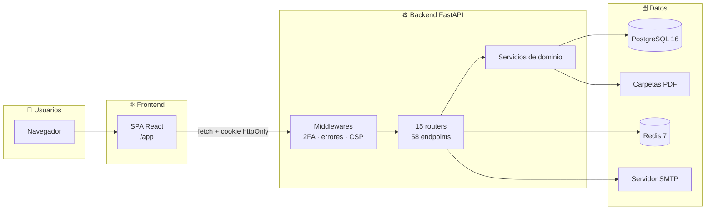

### 2. Recorrido de una solicitud

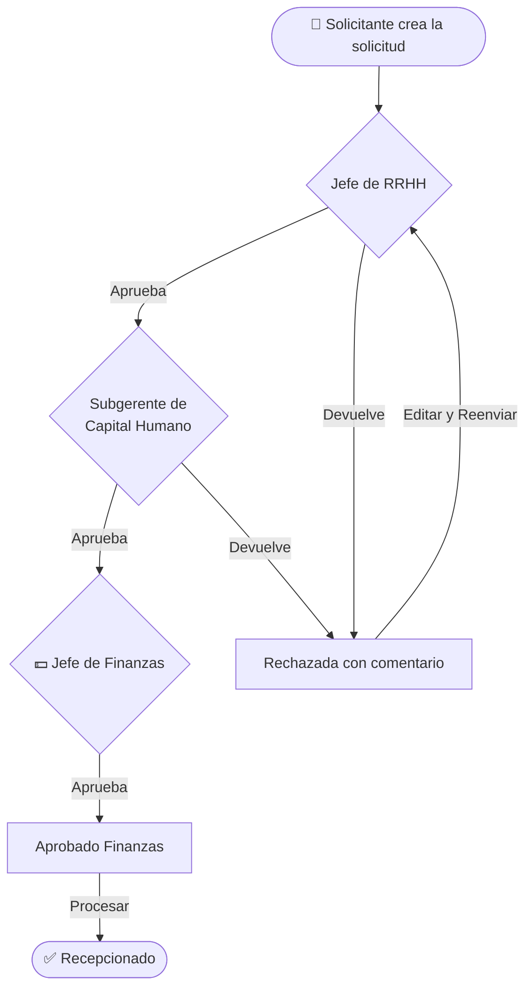

### 3. Inicio de sesión con verificación en dos pasos

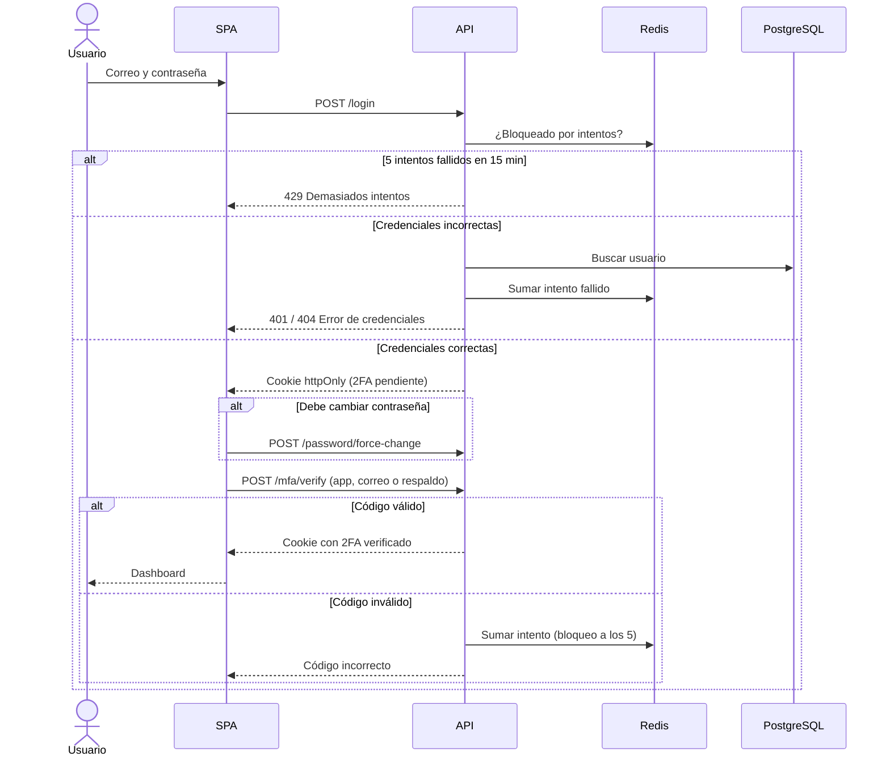

### 4. Dispositivo de confianza: menos fricción sin perder control

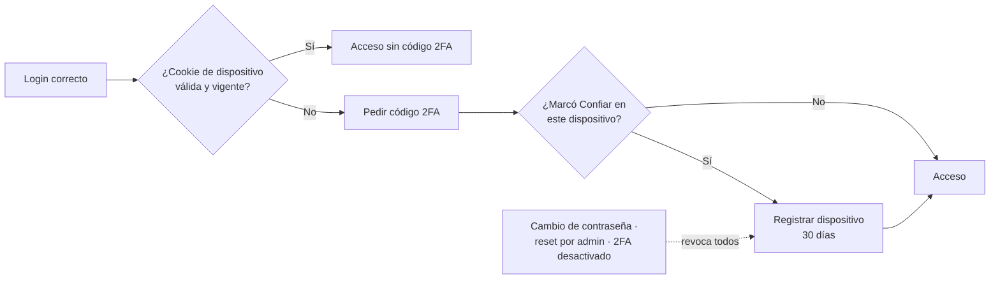

### 5. Modelo de datos

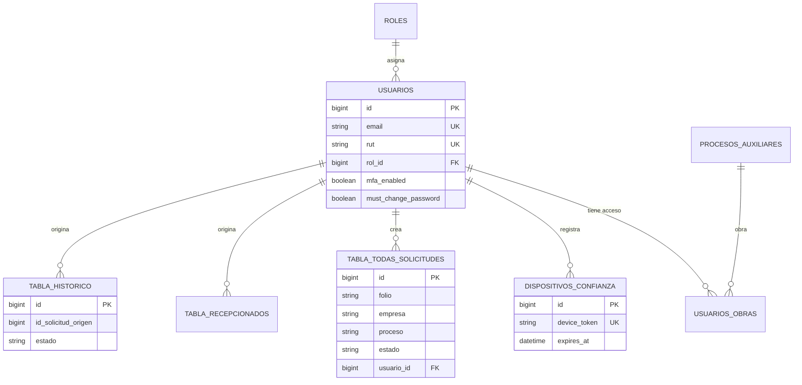

> `empresas` y `procesos` son catálogos que la solicitud guarda por nombre, sin clave foránea.

---

## 📋 Requisitos previos

**Para usar la aplicación (usuario final)**

| Necesitas | Detalle |
|---|---|
| 🌐 Navegador actualizado | Chrome, Edge, Firefox o Safari, en computador, tablet o móvil. |
| 👤 Cuenta corporativa | Correo `@flujopago.cl` o `@grupodemo.cl` y la contraseña temporal que entrega el administrador. |
| 📱 Segundo factor | Una app de autenticación (Google Authenticator, Authy u otra compatible) **o** acceso a tu correo. |
| 📎 Respaldos | Los PDF de cada folio (máximo 10 MB por archivo). |

**Para instalarla (perfil técnico)**

| Requisito | Versión | Para qué se necesita | ¿Obligatorio? |
|---|---|---|---|
| Docker + Docker Compose | Compose v2 | Levantar PostgreSQL, Redis, la app y el respaldo | ✅ Con Docker |
| Node.js | 22 (la imagen usa `node:22`) | Compilar el frontend (`frontend/dist`) en el host | ✅ Salvo si solo construyes la imagen |
| Python | 3.11 | Ejecutar el backend sin Docker | Solo desarrollo local |
| PostgreSQL | 16 | Base de datos | Solo desarrollo local |
| Redis | 7 | Bloqueo por intentos, OTP y 2FA | Solo desarrollo local |
| Cuenta SMTP | — | Códigos por correo y contraseñas temporales | Recomendado |

> [!TIP]
> Genera claves propias antes del primer arranque. Si `SECRET_KEY` o `FERNET_KEY` no están definidas, el código usa valores de
> desarrollo conocidos. Y genera `FERNET_KEY` **una sola vez**: si cambia, los 2FA ya configurados dejan de funcionar.
> ```bash
> python -c "import secrets; print(secrets.token_urlsafe(48))"                                   # SECRET_KEY
> python -c "from cryptography.fernet import Fernet; print(Fernet.generate_key().decode())"     # FERNET_KEY
> ```

---

## 🚀 Instalación

### Paso 1 · Configurar las variables de entorno

```bash
cp .env.example .env    # y edita los valores
```

| Variable | Obligatoria | Descripción | Valor por defecto en el código |
|---|:---:|---|---|
| `DATABASE_URL` | ✅ | Conexión a PostgreSQL (`postgresql+asyncpg://...`) | Se arma con `DB_USER`, `DB_PASS`, `DB_HOST`, `DB_PORT`, `DB_NAME` |
| `DB_USER` · `DB_NAME` · `POSTGRES_PASSWORD` | ✅ | Usuario, base y contraseña del contenedor PostgreSQL | — |
| `REDIS_URL` · `REDIS_PASSWORD` | ✅ | Conexión y contraseña de Redis | `redis://...@127.0.0.1:6379/0` |
| `SECRET_KEY` | ✅ | Firma de los JWT | Valor inseguro de desarrollo |
| `FERNET_KEY` | ✅ | Cifrado de los secretos 2FA | Valor inseguro de desarrollo |
| `SMTP_HOST` · `SMTP_PORT` · `SMTP_USER` · `SMTP_PASSWORD` · `SMTP_FROM` | ✅ | Servidor de correo para códigos y contraseñas | `smtp.mailtrap.io:2525` |
| `CORS_ALLOWED_ORIGINS` | ✅ en producción | Dominios autorizados, separados por coma | `localhost` |
| `SEED_SUPER_ADMIN_EMAIL` · `SEED_SUPER_ADMIN_PASSWORD` | ✅ en producción | Cuenta de administrador creada en el primer arranque | Email de ejemplo; sin contraseña por defecto (si falta, se genera y se muestra una vez en el log) |
| `EMAILS_PRUEBA_PERMITIDOS` | Recomendada vacía en producción | Emails fuera de `@flujopago.cl`/`@grupodemo.cl` aceptados en login y alta | Lista histórica de cuentas de prueba |
| `LISTADO_MAX_REGISTROS` | | Tope de seguridad de los listados sin paginar (el frontend no pagina) | `10000` |
| `ALLOWED_EMAIL_DOMAINS` | | Dominios aceptados por el servidor de correo | — |
| `JWT_ACCESS_TOKEN_EXPIRE_SECONDS` | | Duración de la sesión | `86400` (24 h) |
| `LOGIN_MAX_ATTEMPTS` · `LOGIN_LOCK_DURATION_SECONDS` | | Intentos de login y duración del bloqueo | `5` · `900` (15 min) |
| `MFA_MAX_ATTEMPTS` · `MFA_LOCK_DURATION_SECONDS` | | Intentos de 2FA y duración del bloqueo | `5` · `900` |
| `EMAIL_OTP_EXPIRE_SECONDS` · `EMAIL_OTP_RATE_LIMIT_SECONDS` | | Vigencia del código por correo y espera entre envíos | `300` · `60` |
| `MFA_BACKUP_CODES_COUNT` · `MFA_ISSUER_NAME` | | Cantidad de códigos de respaldo y nombre en la app 2FA | `10` · `FlujoPago` |

> Con `docker-compose.yml`, **todas** las variables de `.env.example` deben tener valor: Compose las pasa tal cual y una vacía
> impide el arranque.

### Paso 2 · Elegir cómo ejecutar

<details open>
<summary><b>🐳 Docker Compose (recomendado)</b></summary>

```bash
cd frontend && npm ci && npm run build && cd ..   # el volumen .:/code usa el dist/ del host
docker compose up -d --build
docker compose logs -f app                        # esperar "Aplicación iniciada exitosamente"
```

Abre **http://localhost:8000/flujopago/gestion-pagos/v1/app/**. La documentación interactiva de la API queda en `http://localhost:8000/docs`.

Servicios: `app` (puerto 8000), `db` (PostgreSQL, solo red interna), `redis` (6379) y `db-backup` (volcado diario en `backups/db`,
con 7 diarios, 4 semanales y 12 mensuales).

</details>

<details>
<summary><b>💻 Desarrollo local (backend + Vite con recarga en caliente)</b></summary>

Requiere PostgreSQL 16 y Redis 7 accesibles desde tu equipo, con `DB_HOST` y `REDIS_URL` apuntando a ellos. El servicio `db`
de `docker-compose.yml` no publica su puerto, así que para este modo usa un PostgreSQL local o publica el 5432.

```bash
python3.11 -m venv venv && source venv/bin/activate
pip install -r requirements.txt
uvicorn app.main:app --reload --port 8000

# en otra terminal
cd frontend && npm ci && npm run dev
```

Abre **http://localhost:5173/flujopago/gestion-pagos/v1/app/**. Vite redirige la API al backend. Para usar otro backend:
`FLUJOPAGO_BACKEND_URL=http://host:puerto npm run dev`.

</details>

<details>
<summary><b>📦 Artefacto de producción (imagen Docker)</b></summary>

El `Dockerfile` compila el frontend en una etapa con Node 22 e instala el backend en `python:3.11-slim` con `uv`.

```bash
docker build -t flujopago .
docker run --env-file .env -p 8000:8000 flujopago
```

Abre **http://localhost:8000/flujopago/gestion-pagos/v1/app/**. Necesita PostgreSQL y Redis accesibles desde el contenedor y HTTPS delante,
para que las cookies salgan con el atributo `Secure`.

</details>

### Cómo funciona el acceso

- **De dónde sale el usuario.** En el primer arranque se crea un Super Administrador con `SEED_SUPER_ADMIN_EMAIL` / `SEED_SUPER_ADMIN_PASSWORD`.
  Él crea al resto desde **Administración → Usuarios**, asigna el rol, el cargo y las obras, y el sistema genera una contraseña temporal
  que puede enviarse con **Enviar por correo**.
- **Primer ingreso.** La contraseña temporal obliga a definir una nueva (mínimo 8 caracteres, con mayúscula, número y símbolo) y luego a
  activar el 2FA escaneando un QR. El Super Administrador está exceptuado del cambio forzado, pero no del 2FA.
- **Olvidé mi contraseña.** No hay recuperación por autoservicio. El administrador usa **Restablecer**, que genera una nueva contraseña
  temporal, desactiva el 2FA del usuario y revoca sus dispositivos de confianza.
- **Si falta la configuración.** Sin `frontend/dist`, la ruta `/app` responde 503 con la instrucción de compilación. Sin Redis, la app
  funciona, pero **sin bloqueo por intentos** (falla abierto). Sin SMTP, el código por correo no llega, aunque la app de autenticación
  sigue disponible.
- **Límites de seguridad.** 5 intentos de login y 5 de 2FA por usuario e IP cada 15 minutos. 1 código por correo cada 60 segundos.
  Sesión de 24 horas.

---

## 📖 Manual de uso

**Paso 1 · Ingresar.** Abre la dirección que te dio tu área de TI, escribe tu correo corporativo y tu contraseña y presiona
**Ingresar al Sistema**. Si es tu primer ingreso, define tu nueva contraseña y presiona **Guardar y Continuar**.

**Paso 2 · Verificar tu identidad.** La primera vez, escanea el código QR con tu app de autenticación y presiona **Activar 2FA**.
En los ingresos siguientes, escribe el código de 6 dígitos y presiona **Validar Identidad**. ¿No tienes el teléfono a mano? Usa
**Enviar código por Correo** o **Ingresar con Respaldo** con uno de tus códigos de recuperación. Si en el login activaste
**Confiar en este dispositivo**, durante 30 días no se te pedirá el código en ese equipo.

**Paso 3 · Crear una solicitud.** En el menú, entra a **Nueva Solicitud**:
1. Elige el mes de proceso, las fechas, la empresa, la obra y el proceso.
2. Escribe cada folio con su monto y forma de pago y adjunta su PDF con **Seleccionar PDF** (usa **Agregar otro folio**, hasta 5).
3. Presiona **Validar y Previsualizar**, revisa el resumen y confirma con **Confirmar Solicitud**.

**Paso 4 · Seguir y enviar.** En **Mis Solicitudes** verás el estado de cada una. Las que quedaron en espera se envían con
**Enviar a Aprobación**. Si te devuelven una, abre el detalle, lee el comentario y usa **Editar y Reenviar**.

**Paso 5 · Aprobar (jefaturas).** En **Aprobación RRHH** o **Aprobación SCP**, usa el botón verde ✓ para aprobar o el botón ↺ para
devolver con un comentario, y confirma con **Confirmar Acción**. Para varias a la vez, márcalas y presiona **Aprobar Múltiples solicitudes**.

**Paso 6 · Procesar el pago (Finanzas).** En **Finanzas**, marca las solicitudes y presiona **Procesar Seleccionadas**. En las tarjetas
de tipo *Recepcionado*, adjunta los respaldos con **Subir PDF Firmados**. Exporta lo aprobado con **Exportar a Excel (XLSX)**. Los
reportes completos están en **Reportes**.

**Si ves este mensaje… / Qué hacer**

| Si ves este mensaje… | Qué hacer |
|---|---|
| «Error de Credenciales: Email o contraseña incorrectos» | Revisa mayúsculas y que el correo sea el corporativo. |
| «El email ingresado no está registrado en el sistema» | Confirma tu correo con el administrador: tu cuenta aún no existe. |
| «Demasiados intentos fallidos. Intente nuevamente en 15 minutos.» | Espera 15 minutos. Si olvidaste la contraseña, pide un restablecimiento al administrador. |
| «Por favor ingrese un email válido (@flujopago.cl o @grupodemo.cl)» | Ingresa con tu correo corporativo, no con uno personal. |
| «Código incorrecto» | Revisa que la hora de tu teléfono sea automática y escribe el código vigente, o pide uno por correo. |
| «Su sesión ha expirado. Por favor, inicie sesión nuevamente.» | Vuelve a ingresar. La sesión dura 24 horas. |
| «Faltan campos obligatorios: …» | Completa los campos marcados en rojo que se listan en el mensaje. |
| «El folio '…' ya existe en …» | Ese folio ya fue registrado. Revísalo en **Estados de Solicitudes** antes de volver a cargarlo. |
| «El archivo no puede exceder 10MB» / «Solo se permiten archivos PDF» | Adjunta un PDF de menos de 10 MB. |
| «No se pudo conectar con el servidor. Verifique su conexión a internet» | Revisa tu conexión y vuelve a intentar. Si persiste, avisa a TI. |

> [!TIP]
> ¿Dudas con un campo o una columna? Presiona el botón **?** junto al título de la sección: abre una ayuda con la explicación y
> consejos de llenado. Hay 15 temas de ayuda en el formulario y las tablas.

---

## 🔐 Seguridad

| Riesgo | Cómo se mitiga |
|---|---|
| Robo de contraseñas | Hash Argon2id (`argon2-cffi`). Política mínima de 8 caracteres con mayúscula, número y símbolo. Cambio obligatorio de la contraseña temporal. |
| Acceso con credenciales filtradas | 2FA obligatorio: TOTP, código por correo de 6 dígitos (vigente 5 min) o códigos de respaldo de un solo uso. Secretos TOTP cifrados con Fernet. |
| Fuerza bruta | Redis bloquea 15 minutos tras 5 intentos de login o de 2FA, por usuario e IP. El código por correo se limita a 1 envío por minuto. |
| Robo de sesión por XSS | JWT en cookie `httpOnly` (inaccesible desde JavaScript) y CSP estricta en la SPA (`script-src 'self'`, sin scripts en línea ni CDN). |
| CSRF | Cookies `SameSite=lax`, CORS limitado a orígenes configurados y con credenciales. |
| Escalamiento de privilegios | Las escrituras sobre usuarios, empresas, procesos y obras exigen `require_admin` en el servidor. El **flujo de aprobación se aplica en el backend**: un Solicitante no puede aprobar niveles, marcar Finanzas, recepcionar ni pagar (`app/infrastructure/security/permisos.py`). |
| Acceso a datos ajenos (IDOR) | PDFs por folio, recepcionados, PDF firmados/autorización e histórico exigen ser dueño del registro o tener el rol del flujo correspondiente; el padrón de usuarios es solo para Administración. Los homónimos no se controlan entre sí. |
| Acceso a PDF ajenos | Los PDF no se publican como estáticos: se descargan por endpoints con JWT que validan que la ruta quede dentro de la carpeta permitida. Se guardan siempre como `.pdf` y cualquier otro tipo se entrega como descarga, nunca como HTML. |
| Credenciales en el código | Sin contraseñas por defecto ni cuentas de prueba sembradas; la antigua cuenta de prueba se neutraliza automáticamente al arrancar. |
| Inyección SQL | Consultas con el ORM de SQLAlchemy. El SQL textual solo aparece en migraciones fijas, sin datos del usuario. |
| Fuga de información en errores | Un middleware enmascara las excepciones internas y responde con mensajes genéricos. |
| Ataques por el navegador | Cabeceras `X-Content-Type-Options`, `X-Frame-Options`, `Referrer-Policy`, `Permissions-Policy` y `Strict-Transport-Security` en cada respuesta. |
| Dependencias vulnerables | GitHub Actions diario con `safety`, `pip-audit`, revisión de licencias y SBOM CycloneDX. |

---

## 🧪 Calidad y pruebas

```bash
# Backend completo (recomendado): unitarias + integración REAL contra PostgreSQL y Redis efímeros en Docker.
# No toca la base de datos de desarrollo/producción.
scripts/run_backend_tests.sh                 # 79 unitarias + ~270 casos de integración
scripts/run_backend_tests.sh integration     # solo integración (acepta argumentos de pytest)

# Solo unitarias sin Docker (pytest-asyncio es obligatorio: sin él, 44 tests async se omiten en silencio)
pip install -r requirements.txt -r requirements-dev.txt
python -m pytest app/tests -q

# Frontend: 168 casos en 22 archivos (Vitest + Testing Library), tipos y linter
cd frontend
npm test
npm run typecheck
npm run lint

# E2E: 60 casos contra el stack real (PostgreSQL + Redis + Mailpit), 80 ejecuciones en 5 perfiles de navegador
docker compose -p flujopago-e2e -f e2e/docker-compose.e2e.yml --env-file e2e/.env.e2e up -d --build
npm run build && npm run test:e2e
```

Cubren el ciclo completo de una solicitud con PDF reales, el login con 2FA y OTP por correo, el CRUD de administración, los permisos
por rol, el bloqueo por intentos, el enmascarado de errores y el diseño responsive de 320 px a 4K.

La suite de integración (`tests/integration/`) verifica el estado real en base de datos, disco y Redis tras cada operación: permisos y
aislamiento entre usuarios y obras, transiciones del flujo, rollback sin datos parciales, archivos huérfanos y concurrencia. El detalle de
la auditoría de endpoints (hallazgos, correcciones y riesgos pendientes) está en [docs/AUDITORIA_ENDPOINTS_2026-11.md](docs/AUDITORIA_ENDPOINTS_2026-11.md).

---

## 📁 Estructura del proyecto

```text
.
├── app/                      Backend FastAPI
│   ├── domain/               Modelos ORM, DTO y servicios de negocio (solicitudes, 2FA, histórico)
│   ├── infrastructure/       Base de datos y seed, seguridad (JWT, Argon2, Redis), correo y middlewares
│   ├── interfaces/api/       Routers REST y plantillas de páginas de error
│   ├── tests/                Pruebas pytest unitarias y scripts de verificación manual
│   └── main.py               Arranque, middlewares y registro de routers
├── tests/integration/        Pruebas de integración reales (PostgreSQL + Redis efímeros)
├── scripts/run_backend_tests.sh  Ejecuta toda la suite backend en Docker aislado
├── frontend/                 SPA React + TypeScript
│   ├── src/features/         Una carpeta por sección (aprobaciones, finanzas, reportes...)
│   ├── src/components/       Layout, modales, notificaciones, visor PDF y ayuda
│   ├── src/styles/           Tokens de diseño, componentes y tema oscuro
│   └── e2e/                  Pruebas Playwright contra el stack real
├── e2e/                      docker-compose aislado para las pruebas E2E
├── scripts/                  Plantilla de respaldo hacia AWS S3
├── docs/screenshots/         Capturas de este README (datos ficticios)
├── .github/workflows/        Auditoría diaria de dependencias
├── Dockerfile                Imagen multietapa (Node 22 → Python 3.11)
└── docker-compose.yml        app + PostgreSQL + Redis + respaldo diario
```

La documentación ampliada está en [DOC_API_DOCUMENTATION.md](DOC_API_DOCUMENTATION.md), [DOC_INSTALLATION.md](DOC_INSTALLATION.md)
y [DOC_SPECIAL_FEATURES.md](DOC_SPECIAL_FEATURES.md).

---

## ❓ Preguntas frecuentes

<details>
<summary><b>¿La aplicación modifica mis datos o los de otras áreas?</b></summary>

Solo guarda lo que tú registras y las decisiones de aprobación. Una persona sin rol elevado ve y crea solicitudes únicamente de las
obras que tiene asignadas. Cada cambio de estado queda en un histórico que no se edita desde la interfaz.

</details>

<details>
<summary><b>¿Pueden usarla varias personas al mismo tiempo?</b></summary>

Sí. Es multiusuario: cada persona tiene su cuenta, su rol y su propia sesión. Las listas se actualizan después de cada acción.

</details>

<details>
<summary><b>La aplicación no arranca o muestra un error 503.</b></summary>

Un 503 en `/app` significa que falta compilar el frontend: ejecuta `cd frontend && npm ci && npm run build`. Si el contenedor `app`
se reinicia en bucle, revisa que **todas** las variables de `.env.example` tengan valor y que `DB_USER` y `DB_NAME` coincidan con
el *healthcheck* de PostgreSQL definido en `docker-compose.yml`.

</details>

<details>
<summary><b>Olvidé mi contraseña o cambié de teléfono.</b></summary>

Pide al administrador que use **Restablecer** en tu usuario. Recibirás una contraseña temporal, definirás una nueva y volverás a
configurar el 2FA. Si solo cambiaste de teléfono y conservas tus códigos de recuperación, entra con **Ingresar con Respaldo**.

</details>

<details>
<summary><b>No me llega el código por correo.</b></summary>

Revisa la carpeta de spam y espera un minuto antes de pedir otro (hay un límite de un envío por minuto). El código vence en
5 minutos. Mientras tanto, puedes usar la app de autenticación o un código de recuperación.

</details>

---

## 🚧 Limitaciones conocidas y próximos pasos

| Hoy | Evolución propuesta |
|---|---|
| Si `SECRET_KEY` o `FERNET_KEY` faltan, el código usa valores por defecto conocidos. | Abortar el arranque en producción si no están definidas. |
| Sin Redis, el bloqueo por intentos se desactiva (falla abierto). | Fallar cerrado en producción o alertar cuando Redis no responde. |
| El login responde distinto si el correo no existe (404) o si la contraseña es incorrecta (401), lo que permite averiguar qué correos están registrados. | Responder con un único mensaje genérico en ambos casos. |
| El rol viaja en el JWT: un cambio de rol, un restablecimiento o la eliminación del usuario se aplican cuando el token expira (24 h). | Revalidar el usuario contra la base de datos o acortar la sesión. |
| El folio único se valida en código, no con una restricción de base de datos: dos altas simultáneas pueden duplicarlo. | Agregar un índice o bloqueo para cubrir la concurrencia. |
| `/mfa/disable` no limita los intentos de código. | Aplicar el mismo bloqueo de 5 intentos que el resto del 2FA. |
| El frontend no pagina: los listados traen todo hasta `LISTADO_MAX_REGISTROS`. | Paginar en la interfaz cuando el volumen lo justifique. |
| El token de renovación se emite, pero no hay endpoint para usarlo. | Implementar la renovación o dejar de emitirlo. |
| No hay recuperación de contraseña por autoservicio ni cambio de contraseña voluntario en la interfaz (la API `/password/change` existe). | Agregar ambos flujos en **Seguridad**. |
| `docker-compose.yml` expone Redis en el puerto 6379 y el *healthcheck* de PostgreSQL tiene usuario y base fijos. | Quitar el puerto público y usar las variables en el *healthcheck*. |
| `requirements.txt` incluye `passlib` y `fastapi-limiter`, que no se usan. | Limpiar dependencias (las de prueba ya están en `requirements-dev.txt`). |
| El backend no tiene linter configurado. | Incorporar Ruff y ejecutarlo en CI junto a las pruebas. |
| Sin archivo `LICENSE`. | Agregar el aviso de licencia del proyecto. |

---

<div align="center">

**Desarrollado por [Maximiliano Andrés Caniullan Lefiñir](mailto:Max.andres@pushhr.cl)**

Desarrollo *full-stack* · Seguridad de aplicaciones · Flujos de aprobación · UX responsive · Pruebas automatizadas

</div>
